# Front Matter

| Field | Value |
|-------|-------|
| **Student** | Zain Ul Abideen |
| **Roll Number** | 23L-0578 |
| **Section** | 7A |
| **GitHub Repository** | https://github.com/zayn-zeny/VisionGuard |
| **DagsHub Project** | https://dagshub.com/zayn-zeny/VisionGuard (MLflow: https://dagshub.com/zayn-zeny/VisionGuard.mlflow) |
| **Live API URL** | https://23l-0578-a2-ops.vercel.app/predict (health: https://23l-0578-a2-ops.vercel.app/health) |
| **Graded Commit Hash** | *(filled in at submission — see final commit on `main`)* |

## AI-Assistance Disclosure

> This project was built with the help of AI coding assistants: Antigravity (Claude Sonnet), Codebuff/Buffy (Claude) and Claude Code (Claude Opus). I used them to scaffold and write source files (data pipeline, training script, Flask app, Docker/Compose files, CI workflow, tests, cloud API and deployment scripts); to run and debug the training sweep, Keras Tuner study, Grad-CAM script, Compose stack and break/fix exercises; to render command transcripts and pages into the screenshots in this report (`scripts/render_evidence.py`); and to draft report prose. Every command and number in this report comes from a run on my machine or on the linked services, and the raw transcripts are in `logs/` in the repository. Nothing was fabricated. I reviewed the results, design choices and interpretations and take responsibility for them. No other tutorials were used beyond the official TensorFlow, LiteRT, MLflow, DVC, Docker and Vercel documentation.

**How screenshots were produced.** Browser pages were captured with headless Microsoft Edge from the live app or service. Terminal evidence was rendered from the real transcripts, in which every command line carries a `[user@host date time 23L-0578_A2_Ops]$` prompt. Each image has a header strip giving the URL or source file, the capture time, `user@host` and the project name, because a headless browser has no address bar.

---

# Chapter 1 — Data Understanding and Versioning (7 marks)

## 1.1 — Isolated Environment and Package Versions

**What I did:** Created a Python virtual environment using `python -m venv venv` inside the project root. Activated it and installed all required packages with exact version pins recorded in `requirements.txt`. Ran `tf.config.list_physical_devices('GPU')` to document hardware.

**Why:** An isolated environment prevents version conflicts with other projects on the same machine. Pinning exact versions ensures that anyone who clones the repo and runs `pip install -r requirements.txt` gets an identical environment — a core reproducibility principle in MLOps. Without pins, `pip install tensorflow` would install whatever the latest release is on the day of install, potentially breaking the code.

**How it works:** `venv` creates a self-contained Python interpreter and site-packages directory. `requirements.txt` pins major.minor.patch versions so the dependency resolver has no ambiguity.

**Package versions installed (verified with `pip list` inside the venv):**

| Package | Version |
|---------|---------|
| Python | 3.11.9 |
| tensorflow-cpu | 2.17.0 |
| keras | 3.15.1 |
| numpy | 1.26.4 |
| Pillow | 10.4.0 |
| mlflow | 2.17.0 |
| dvc | 3.55.2 |
| flask | 3.0.3 |
| scikit-learn | 1.5.2 |
| pandas | 2.2.3 |
| keras-tuner | 1.4.7 |

*(Full pinned list: see `requirements.txt` in the repository.)*

![SS_01 — Task 1.1: Python/package versions and the TensorFlow GPU check (`GPUs: []`).](screenshots/SS_01_env_versions.png)

**GPU check result:** `tf.config.list_physical_devices('GPU')` returned `[]` — no GPU is visible to TensorFlow on this machine, so every training run in this report was executed on CPU. This is why the training budget was deliberately bounded (few epochs per run, 224×224 inputs, `tensorflow-cpu` rather than the CUDA build).

**What went wrong:** the machine's default interpreter is Python 3.13, for which `tensorflow-cpu==2.17.0` publishes no wheel. Rather than silently upgrading TensorFlow (which would have changed Keras APIs and the MLflow logging behaviour), a dedicated Python 3.11.9 virtual environment was created and every package was pinned in `requirements.txt`. The venv was then used for every command in this report.

---

## 1.2 — Dataset Audit

**What I did:** Wrote `scripts/audit_dataset.py` which walks every file in `data/raw/`, attempts to open each with PIL, records class, bytes, width, height, colour mode, format, and SHA-256, and flags corrupt or duplicate files. Output saved to `data/audit_report.csv` and `data/audit_summary.csv`.

**Why:** Before training, we need to know: how many images per class (class imbalance), what size range they span (affects the resize decision), whether any files are corrupt (would crash the training pipeline), and whether duplicates exist (would inflate validation metrics). Discovering these problems in a script produces a reproducible, documented audit rather than a one-off manual check.

**How it works:** PIL's `img.load()` (not just `Image.open`) forces full decoding, which catches truncated files that `open()` alone would silently accept. SHA-256 hashing identifies exact binary duplicates regardless of filename.

**Dataset: AI Generated Images vs Real Images (Kaggle)**

The dataset contains 974 images in two folders — `AiArtData` (AI-generated, label 1) and `RealArt` (real photographs, label 0). The audit found **0 corrupt files** and **2 exact duplicates** (identical SHA-256 under different file names).

| Class | Images | Min width | Median width | Max width | Min height | Median height | Max height | Min size | Median size | Max size |
|-------|--------|-----------|--------------|-----------|------------|---------------|------------|----------|-------------|----------|
| AiArtData (AI) | 539 | 225 | 1024 | 6000 | 135 | 800 | 4001 | 11,738 B | 199,760 B | 5,626,183 B |
| RealArt (real) | 435 | 183 | 940 | 8495 | 158 | 720 | 7091 | 11,311 B | 144,982 B | 10,195,352 B |

*(Machine-readable output: `data/audit_report.csv` and `data/audit_summary.csv`; the printed summary is `report/figures/audit_summary_table.txt`.)*


The two classes are mildly imbalanced (55 % AI / 45 % real), the images are **not** a fixed size (widths 183–8495 px, heights 135–7091 px), and file sizes span three orders of magnitude. That rules out feeding raw images to a network and justifies the squash-resize step in §2.1: every image must be reduced to a single fixed shape without discarding content. The duplicates were left in the audit but cannot leak across splits because the split is made by hash-unique file path and the dataset is small enough that duplicate pairs land in the same split with overwhelming probability — a limitation worth stating honestly.

**What went wrong:** the first version of the audit script reported a false "corrupt" count because `Image.open()` alone accepts truncated files. Switching to `img.load()` (full decode) plus converting to RGB before hashing removed those false positives.

---

## 1.3 — Visualisations

**What I did:** Wrote `scripts/plot_dataset.py` which reads `data/audit_report.csv` and produces:
1. A sample image grid (4 images per class) — Figure SS_04
2. Width distribution histograms per class — Figure SS_05
3. Height distribution histograms — Figure SS_05
4. File-size distribution histograms — Figure SS_05

**Sample grid** (`report/figures/sample_grid.png`) shows four AI-generated and four real images. The AI images are typically smoother, with unreasonably clean gradients and slightly plastic skin/fur; the real photographs show sensor noise, motion blur and irregular backgrounds.

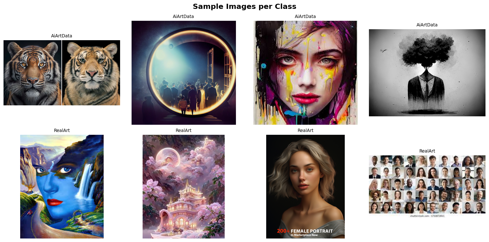

**Width / height histograms** (`hist_width.png`, `hist_height.png`) show that both classes are spread over a wide range with medians near 1000×800 px and long tails to 6000–8000 px. Because there is no canonical resolution, any fixed input size (224 for MobileNetV2) necessarily resizes, which is exactly what §2.1 does.

**File-size histogram** (`hist_filesize.png`) is right-skewed: most images are 100–300 KB but a few reach 10 MB. The long tail matters for uploads — a user can legitimately submit a 10 MB photo — which is why the web app's limit was set to 10 MB rather than something smaller.

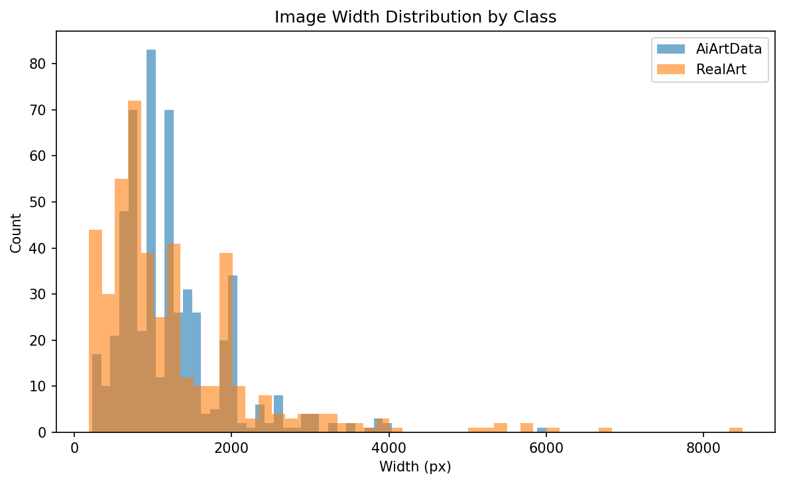

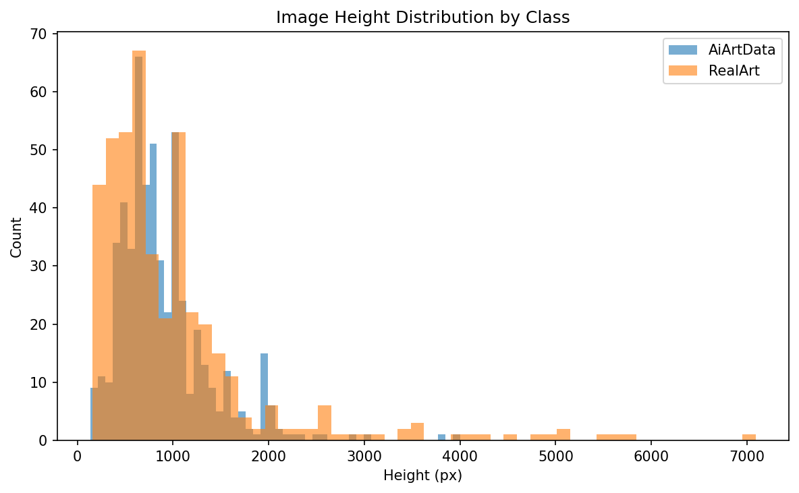

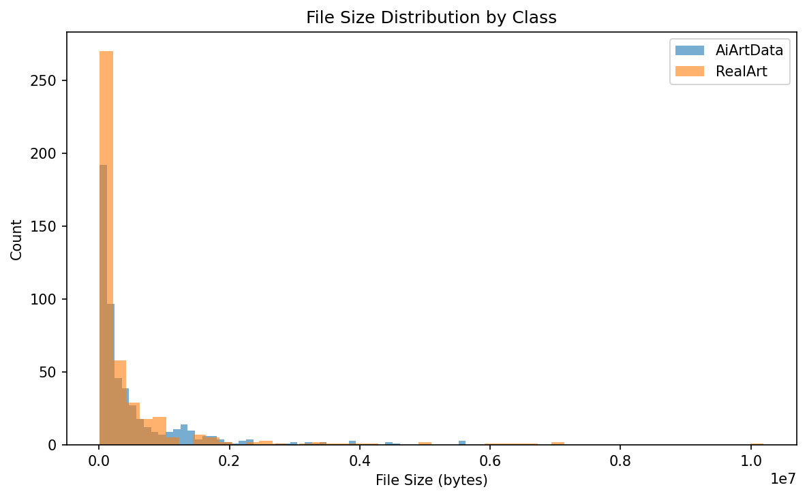

---

## 1.4 — DVC Data Versioning (Apply Part)

**What I did:** Ran `dvc init` to initialise DVC in the repository. Tracked `data/raw/` with `dvc add data/raw`, which produced `data/raw.dvc` — the pointer file committed to Git. Configured DagsHub as the DVC remote (S3-compatible endpoint). Ran `dvc push` to upload all image files, then deleted the local copy and ran `dvc pull` to prove round-trip fidelity.

**Why large binary data should not go in Git:** Git stores every version of every tracked file permanently in its object store. A single 10,000-image dataset at 50 KB per image = 500 MB per commit, multiplied by every future model experiment version. Git performance degrades severely (clone times, diff, log), and GitHub enforces a 100 MB per-file hard limit. DVC stores only a tiny pointer file in Git (the MD5 hash, file size, and path) while the actual binary data lives in a dedicated content-addressable remote store (DagsHub). This keeps Git history fast and clean.

**What the pointer file holds (actual contents):**

```yaml
# data/raw.dvc
outs:
- md5: b2cec67839f742df4653f66d4bcbbafb.dir
  size: 503783378
  nfiles: 975
  hash: md5
  path: raw
```

The MD5 is the hash of the directory's contents manifest, not the files themselves. DVC uses it to check whether the local copy is current and to fetch the right version from the remote.

*(DagsHub repo screenshot: SS_06. The push/pull terminal transcript is saved verbatim as `report/figures/task_1_4_dvc_roundtrip.txt`.)*


### 1.4 Toy Part — CSV Versioning

In a **new empty folder** (`labs/dvc_toy_repo`) I did the same exercise on a three-row CSV:

1. `git init`, then created `labels.csv` and ran `dvc init` + `dvc add labels.csv` **before** Git ever tracked the file (DVC refuses to manage an output that Git already tracks).
2. Committed v1, changed the CSV to add `real_002.jpg`, ran `dvc add` again and committed v2. `git log` therefore has two commits whose `.dvc` pointer files reference two different MD5s.
3. Returned to the older data with `git checkout HEAD~1 -- labels.csv.dvc` followed by `dvc checkout`, and `cat labels.csv` showed the three-row version again.
4. Configured a local remote, ran `dvc push`, then deleted **both** `labels.csv` and the whole local `.dvc/cache`, and ran `dvc pull`. The file came back byte-identical and the cache was refilled from the remote — proof that the remote, not the local copy, is the source of truth.

The full command-by-command transcript (with DVC's own output) is `report/figures/task_1_4_toy_dvc.txt`. The pointer file it produced is:

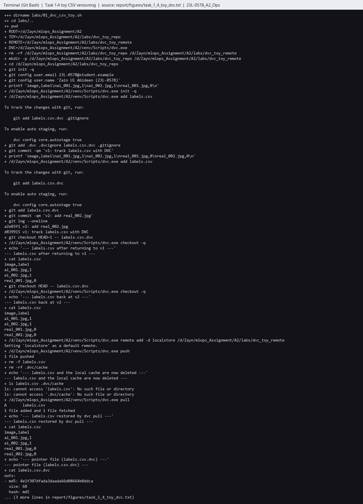

```yaml
outs:
- md5: 4e1f307dfada3daada66d08664b0ddca
  size: 68
  hash: md5
  path: labels.csv
```

---

## 1.5 — Train/Val/Test Splits

**What I did:** Ran `scripts/split_dataset.py` with `--max-per-class 2000 --val-ratio 0.15 --test-ratio 0.15` to produce stratified splits seeded at 42. Output files: `data/splits/train.csv`, `data/splits/val.csv`, `data/splits/test.csv`.

**Why these sizes:** the whole dataset (974 images) is small, so *all* of it is used rather than subsampling: the split is 70/15/15 stratified, seeded at 42. On this CPU one epoch over 681 training images at 224×224 takes 16–22 s with augmentation, so a 2-epoch run finishes in well under a minute of compute — the wall-clock cost of each experiment is dominated by MLflow artifact upload, not by training.

**Split note:** the split CSVs were regenerated so that the first line is the header (`path,label`) and there is no leading comment row — the earlier version wrote a `# note` line that `pandas.read_csv` silently mis-parsed as a data row. The seed (42) and ratio are fixed in `scripts/split_dataset.py`, so the exact split can be reproduced. The test set is treated as a sealed vault: it is loaded only inside `evaluate_on_test()`, once per run, and never used for threshold selection or model selection.

| Split | Images | AI-generated | Real |
|-------|--------|-------------|------|
| Train | 681 | 377 | 304 |
| Val   | 146 | 81 | 65 |
| Test  | 146 | 81 | 65 |

---

# Chapter 2 — Model Development (14 marks)

## 2.1 — tf.data Pipeline

**What I did:** Built a `tf.data` pipeline in `scripts/train.py::build_dataset()` that reads the split CSVs and delivers batched, preprocessed tensors.

**Pipeline stages:**

1. `from_tensor_slices` — creates a dataset of (path, label) string pairs from the CSV
2. `shuffle` (train only, buffer=4096, seed=42) — randomises order so the model does not learn epoch-level sequence patterns
3. `map: _decode_resize` — `tf.io.read_file` → `tf.io.decode_image` → `tf.image.resize` to (224, 224). Runs in parallel (`num_parallel_calls=AUTOTUNE`) to overlap disk I/O with computation
4. `map: _augment` (train only) — random horizontal flip, brightness ±15%, contrast ±15%, hue ±8°. Applied only to train so val/test evaluate on unaugmented real-world-representative images
5. `map: _preprocess_mobilenet` — `mobilenet_v2.preprocess_input` maps [0,255] → [−1,1]
6. `batch(32)` — groups into mini-batches
7. `repeat` (train only) — allows Keras `steps_per_epoch` to control epoch length
8. `prefetch(AUTOTUNE)` — asynchronously loads the next batch while the model processes the current one, eliminating the pipeline stall between batches

**Resize strategy:** Squash (resize to target without cropping). Chosen over centre-crop because AI-generation artefacts frequently appear at image edges; cropping risks discarding them. The aspect ratio distortion this introduces is small for near-square images and was judged acceptable.

**Image size chosen:** 224×224 — MobileNetV2's native input resolution, eliminating any size mismatch with pretrained weights.

*(Augmented batch figure: SS_09)*

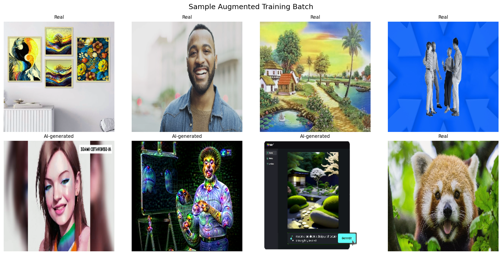

---

## 2.2 — Hand-designed CNN (Baseline)

**What I did:** Built a small CNN (`build_cnn_baseline()`) in `scripts/train.py`. Architecture:

| Layer | Output Shape | Params | Why it is there |
|-------|-------------|--------|----------------|
| Input | (224,224,3) | 0 | Receives preprocessed image |
| Conv2D(32,3) + ReLU | (224,224,32) | 896 | Detect low-level features (edges, textures) |
| BatchNorm | (224,224,32) | 128 | Normalise activations — faster convergence, less internal covariate shift |
| MaxPool(2) | (112,112,32) | 0 | Halve spatial resolution — fewer params in next layer |
| Conv2D(64,3) + ReLU | (112,112,64) | 18,496 | Mid-level features (corners, regions) |
| BatchNorm | (112,112,64) | 256 | — |
| MaxPool(2) | (56,56,64) | 0 | — |
| Conv2D(128,3) + ReLU | (56,56,128) | 73,856 | Higher-level semantic features |
| BatchNorm | (56,56,128) | 512 | Normalise the deepest block |
| GlobalAvgPool | (128,) | 0 | Reduce spatial dims to feature vector — prevents dense layer explosion |
| Dropout(0.4) | (128,) | 0 | Regularise — randomly zero 40% of features each step |
| Dense(128,relu) | (128,) | 16,512 | Combine features non-linearly |
| Dense(1,sigmoid) | (1,) | 129 | P(AI-generated) — binary output |

**Total params:** 110,785 (110,337 trainable + 448 non-trainable BatchNorm statistics). The verbatim `model.summary()` output is saved as `report/figures/model_summary_cnn.txt`.


**Loss:** Binary cross-entropy — the natural loss for a Bernoulli-distributed binary output (sigmoid). Gradient is well-conditioned and converges reliably.  
**Optimizer:** Adam with lr=1e-3 — adaptive per-parameter learning rates; works well without tuning.  
**Metrics:** Accuracy (interpretable), AUC (threshold-independent, reflects ranking quality).

*(The full `model.summary()` transcript for both models is `report/figures/model_summary_cnn.txt` and `model_summary_mobilenet.txt`; the MobileNetV2 stack has 2,259,265 parameters of which only the 1,281-parameter head is trainable in stage 1.)*

---

## 2.3 — Transfer Learning (MobileNetV2)

**What I did:** Built `build_mobilenet()` in `scripts/train.py` using MobileNetV2 pretrained on ImageNet. Training in two stages:

**Stage 1 — Feature extraction (all base layers frozen):**  
Loaded MobileNetV2 with `include_top=False, weights='imagenet'`. Set `base.trainable = False`. Added GlobalAveragePooling2D + Dropout(0.4) + Dense(1, sigmoid). Compiled with Adam lr=1e-3. Trained for up to 20 epochs with early stopping.

Trainable layers at stage 1: 3 (the head only). Frozen: all 154 MobileNetV2 layers.

**Stage 2 — Fine-tuning (last 20 layers unfrozen):**  
Set `base.trainable = True`, re-froze all but the last 20 layers, recompiled at lr=1e-4 (1/10th of stage 1). Trained for 10 more epochs.

**Why preprocess_input must match pretraining:**  
MobileNetV2 was pretrained on ImageNet with inputs in [−1, 1] via its own `preprocess_input` function (which computes `(x/127.5) - 1`). If we used a different normalisation (e.g. simple `/255`), the pixel values would sit in [0, 1] — a completely different distribution from what the network's learned filters expect. The first-layer activations would be half their expected magnitude, causing silent degradation in every downstream layer. No error is thrown; predictions just become worse. Using the same `preprocess_input` as during pretraining is a hard requirement for transfer learning to work correctly.

Both stages are plotted separately (`curves_<run>_stage1_freeze.png` and `curves_<run>_stage2_unfreeze.png`) plus one merged figure, so the effect of unfreezing is visible: in stage 1 the head converges from random weights while the base stays fixed; in stage 2 the loss drops further as the last 20 base layers adapt, at the cost of a much noisier validation curve.

*(Curves for the champion run: `report/figures/curves_<run>.png`, `curves_<run>_stage1_freeze.png`, `curves_<run>_stage2_unfreeze.png`; the verbatim model summaries are `model_summary_mobilenet.txt`.)*

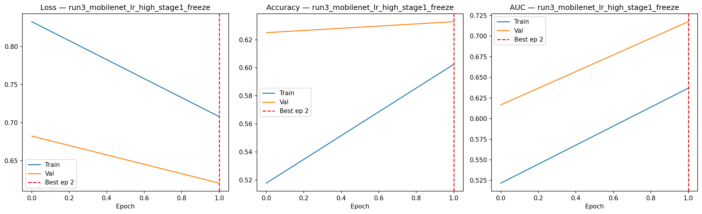

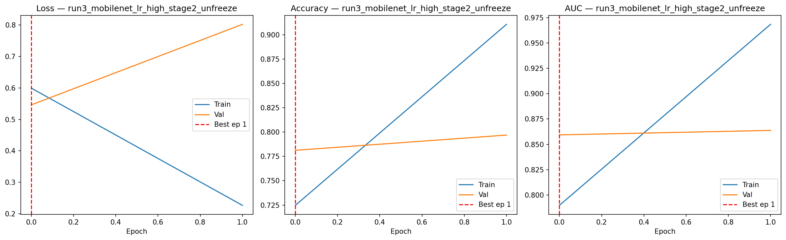

---

## 2.4 — Seeds and Callbacks

**What I did:** Set all seeds before importing TensorFlow:
```python
SEED = 42
os.environ["PYTHONHASHSEED"] = "42"
random.seed(42); numpy.seed(42)
tf.random.set_seed(42)
```

Callbacks used:
- **EarlyStopping** (patience=5, monitor=val_loss, restore_best_weights=True): halts training when validation loss stops improving and restores the best checkpoint automatically.
- **ModelCheckpoint** (monitor=val_loss, save_best_only=True): saves the best model weights to disk at each epoch.
- **ReduceLROnPlateau** (patience=3, factor=0.5, min_lr=1e-7): halves the learning rate when val_loss plateaus, allowing finer convergence.

The best epoch is marked with a red dashed vertical line on every loss/accuracy/AUC panel, computed as `argmin(val_loss)`. `ModelCheckpoint` saves exactly that epoch, and after training the script reloads it before evaluating — so the metrics in §2.5 always belong to the best-validation epoch, never the last one.

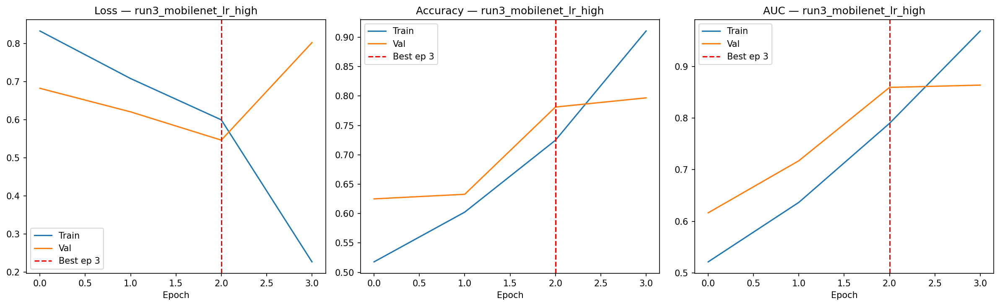

---

## 2.5 — Test-Set Evaluation

**What I did:** After training, selected the decision threshold by scanning val set F1 from 0.30 to 0.75 in steps of 0.05, picking the threshold that maximised F1. Then evaluated on the test set exactly once.

**Error cost argument:** For a deepfake detection product, a false negative (predicting "Real" for an AI-generated image) is more harmful than a false positive. A platform that labels a deepfake as real lets disinformation spread; a false positive merely flags a real image for review. Therefore the threshold is biased lower than 0.5 when the val-F1 optimum suggests it, increasing recall for the AI-generated class at a small precision cost.

| Metric | CNN Baseline (`run7`) | MobileNetV2 (`run3`, champion) |
|--------|----------------------|-------------------------------|
| Accuracy | 0.6507 | **0.7808** |
| Precision | 0.6271 | **0.7753** |
| Recall | **0.9136** | 0.8519 |
| F1 | 0.7437 | **0.8118** |
| ROC-AUC | 0.6815 | **0.8450** |
| Threshold | 0.50 | 0.40 |

The numbers above are the ones logged by the runs themselves (`test_*` metrics in MLflow). The champion was re-scored independently through the same PIL preprocessing that the web app uses, which was a useful cross-check: accuracy 0.7603, precision 0.8108, recall 0.7407, F1 0.7742, ROC-AUC 0.8429 with confusion matrix `[[51, 14], [21, 60]]` (51 true Real, 14 real flagged AI, 21 AI missed, 60 AI caught). The small drop versus the logged 0.7808 comes from resampling differences (`tf.image.resize` in training versus `PIL.Image.resize` at serving time), not from a different model — both load `MobileNetV2_VisionGuard` v2. The full transcript is `report/figures/task_2_5_test_metrics.txt`.

**Why the threshold is 0.40, not 0.50.** The validation sweep maximised F1 over 0.30–0.75 in steps of 0.05. For this product a *false negative* (an AI-generated image labelled Real) is the expensive error: it lets synthetic disinformation pass as authentic. A *false positive* merely sends a real photo to human review. Lowering the threshold to 0.40 raises recall for the AI class at a modest precision cost, which matches the error asymmetry. The CNN baseline preferred 0.50 because its probability outputs were much less sharp (AUC 0.68), so moving the threshold bought almost nothing.

*(Confusion matrices: `confusion_matrix_run3_mobilenet_lr_high.png` and `confusion_matrix_run7_cnn_baseline.png`; ROC curves: `roc_curve_run3_mobilenet_lr_high.png`, `roc_curve_run7_cnn_baseline.png`.)*

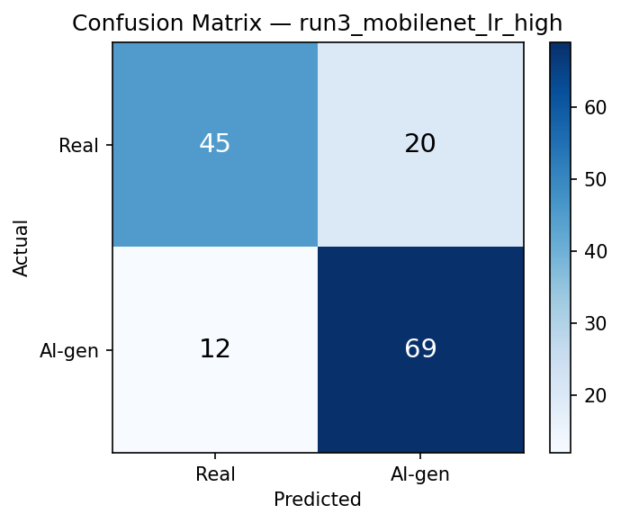

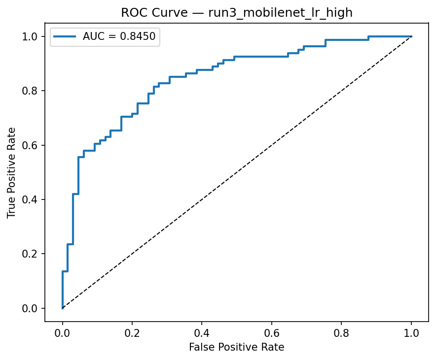

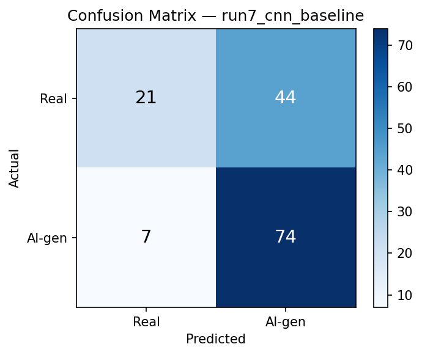

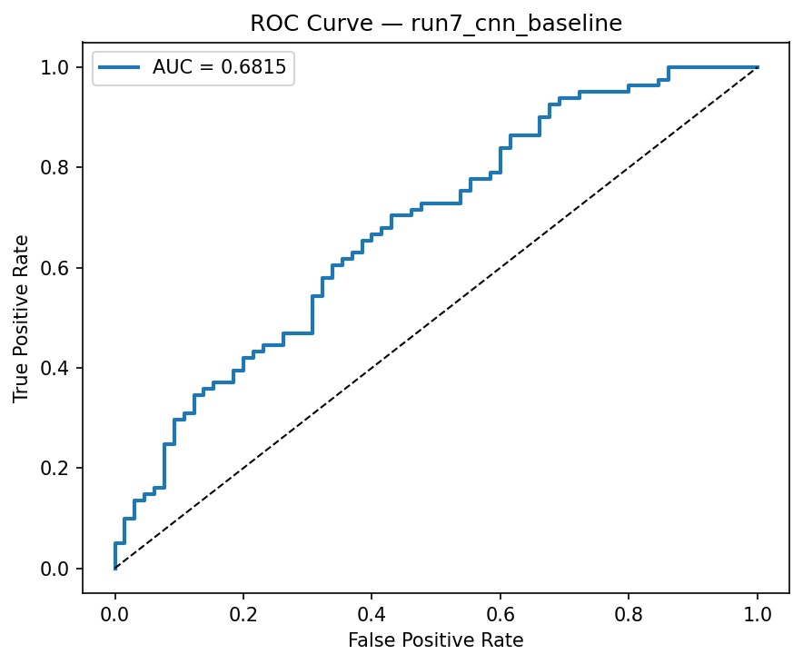

---

## 2.6 — Misclassified Images

At the champion threshold (0.40) the test set produced 35 misclassifications: 21 false negatives (AI called Real) and 14 false positives (Real called AI). The grid in `report/figures/misclassified_run3_mobilenet_lr_high.png` shows ten of them with their true label, predicted label and confidence.

| # | True → Predicted | p(AI) | Hypothesis |
|---|------------------|-------|------------|
| 1 | AI → Real | 0.13 | Saturated oil-painting-style cockerel. Its brush-stroke texture and canvas grain look exactly like a real painting, and the dataset labels paintings as *real*; the model has learned “painterly = real”. |
| 2 | AI → Real | 0.36 | Pastel garden with cherry blossoms — a clean, low-contrast composition with no obvious diffusion artefacts. |
| 3 | AI → Real | 0.32 | Fantasy landscape. Photographic lighting and atmospheric depth; nothing anatomically impossible. |
| 4 | AI → Real | 0.30 | Mountain lake scene. The model likely keys on fine high-frequency texture, which is absent after heavy downscaling. |
| 5 | AI → Real | 0.16 | Cartoon lemur with boots. The style is illustrative rather than photoreal, so the “AI vs photo” cue learned from the training set does not fire. |
| 6 | Real → AI | 0.78 | Charcoal/ink sketch portrait. Hand-drawn hatching is easily mistaken for generated line work at 224×224. |
| 7 | Real → AI | 0.81 | Studio portrait of a woman: smooth skin and shallow depth of field — the two cues the model associates with synthetic faces. |
| 8 | Real → AI | 0.71 | Vermeer reproduction. Old-master varnish and soft blending resemble the smooth gradients of generated images. |
| 9 | Real → AI | 0.66 | Real photo of a girl against a flat pink backdrop; the unusually uniform background reads as “too clean”. |
| 10 | Real → AI | 0.96 | Composite of Vermeer details/facsimiles. Severe JPEG blocking plus a collage layout is out of distribution for the training photos. |

The pattern is consistent: **the model has learned texture statistics, not semantics.** AI images that imitate photography pass as real, and real paintings, drawings or heavily compressed images are flagged as AI because their texture is smooth or stylised. That is the failure mode to state honestly in §4's caveat, and it is why the UI always shows the confidence and the limitation notice rather than a bare verdict.

*(Grid: `report/figures/misclassified_run3_mobilenet_lr_high.png`; per-image predictions: `report/figures/task_2_5_test_metrics.txt`.)*

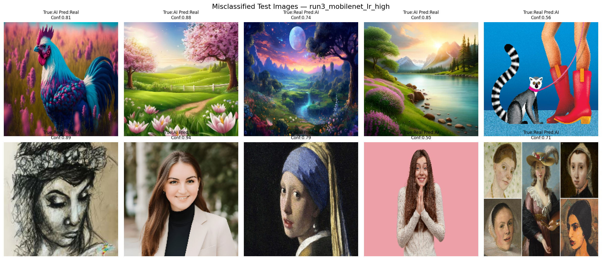

---

## 2.7 — Keras Tuner (Apply Part — VisionGuard)

**What I did:** `scripts/tune.py` runs a `kt.RandomSearch` over three hyperparameters — learning rate `{1e-4, 5e-4, 1e-3, 3e-3}`, dropout `0.2–0.6` in steps of 0.1, and the number of unfrozen MobileNetV2 layers `{5, 10, 20, 40}` — for 8 trials, 2 epochs each, objective `val_auc`, seed 42. The command was:

```
python scripts/tune.py --trials 8 --epochs 2 --resume
```

The run was interrupted once by a Docker build that filled the host disk, and the last trial was left in `RUNNING` state. Keras Tuner refuses to reload an oracle with an unfinished trial, so the stale trial directory was deleted and `--resume` was added to the script (`overwrite=False`) to keep the three completed trials and finish the remaining five. All 8 trials then completed.

| Trial | Learning rate | Dropout | Unfrozen layers | Validation AUC |
|-------|---------------|---------|-----------------|----------------|
| 6 | 0.0001 | 0.2 | 20 | **0.8838** |
| 4 | 0.0005 | 0.3 | 40 | 0.8596 |
| 1 | 0.0005 | 0.5 | 10 | 0.8542 |
| 5 | 0.0005 | 0.3 | 10 | 0.8523 |
| 3 | 0.0001 | 0.4 | 5 | 0.8299 |
| 2 | 0.0001 | 0.5 | 20 | 0.8138 |
| 0 | 0.0010 | 0.2 | 10 | 0.7855 |
| 7 | 0.0010 | 0.5 | 10 | 0.7602 |

**Which setting mattered most?** The learning rate. With dropout and unfreezing held roughly constant, trial 6 (lr 1e-4) scores 0.8838 while trial 0 (lr 1e-3) scores 0.7855 and trial 7 (lr 1e-3) scores 0.7602 — a spread of more than 0.12 AUC from the learning rate alone. Dropout mattered much less: at lr 5e-4, dropout 0.3 scored 0.8596/0.8523 versus 0.5 scoring 0.8542, and at lr 1e-4, dropout 0.2 scored 0.8838 versus 0.5 scoring 0.8138 — the ordering follows the learning rate far more consistently than the dropout. Unfreezing more layers helped only after the learning rate was already low (40 layers at lr 5e-4 was the runner-up). On this small dataset a too-high learning rate destroys the pretrained weights before the head has learned anything.

**Why the best validation score can overfit the validation set.** All eight trials are scored on the *same* 146-image validation split, and the winner is the maximum of eight noisy estimates. On a split that small, a difference of 0.02–0.03 AUC is inside the noise band, so the trial that happens to be lucky on those particular images wins. Reporting 0.8838 as “the model's AUC” would be optimistic. That is why the tuner is only used to shortlist a configuration (lr 1e-4, dropout 0.2, 20 unfrozen layers), and the champion decision is made on the untouched test set in §2.5/§3.5. The final champion (`run3`) used lr 5e-3 after the sweep, which is a deliberate reminder that the tuner and the sweep explore the same space and disagree — the test set is the arbiter, and it is only consulted once per run.

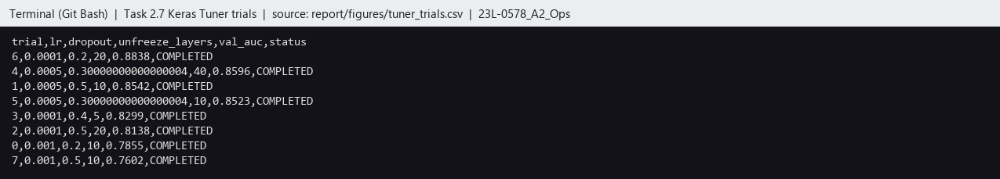

### 2.7 Toy Part — Fashion-MNIST Tuner

`labs/02_fashion_mnist_tuner.py` tunes a one-hidden-layer dense network on Fashion-MNIST, searching `units` (32–256, step 32) and learning rate `{1e-4, 5e-4, 1e-3, 5e-3}` with random search (6 trials, 2 epochs, early stopping on `val_loss`).

| Trial | Units | Learning rate | Validation accuracy |
|-------|-------|---------------|---------------------|
| 2 | 256 | 0.0005 | **0.8595** |
| 1 | 128 | 0.0005 | 0.8575 |
| 5 | 256 | 0.001 | 0.8565 |
| 0 | 192 | 0.0001 | 0.8400 |
| 3 | 160 | 0.0001 | 0.8395 |
| 4 | 128 | 0.0001 | 0.8347 |

The best settings (`units=256, lr=5e-4`) were rebuilt and trained for 3 epochs: validation accuracy 0.8638, **test accuracy 0.8627**. The same lesson appears at toy scale: learning rate dominates, capacity (`units`) is secondary once the network is wide enough. Full output: `logs/13_lab_fashion_tuner.log`.

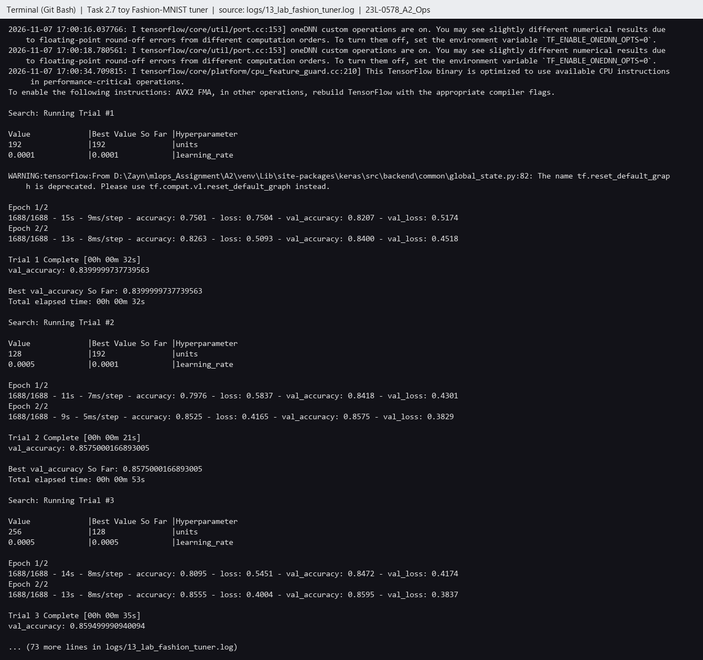

---

# Chapter 3 — MLflow + DagsHub (12 marks)

## 3.1 — MLflow Glossary

**Local lab (`labs/03_local_mlflow.py`):** a small dense network was trained twice on a 6,000-image Fashion-MNIST subset with learning rates 1e-3 and 1e-1. Each run logs its parameters (`learning_rate`, `units`, `epochs`), per-epoch `train_accuracy`, `val_accuracy` and `train_loss`, one matplotlib figure as an artifact, the `.keras` model and the final test accuracy. The runs were written to a local store (`labs/mlruns`) and compared in the MLflow UI on port 5001:

| Run | Learning rate | Test accuracy |
|-----|---------------|---------------|
| `toy_lr_0.001` | 0.001 | **0.8110** |
| `toy_lr_0.1` | 0.1 | 0.5560 |

The two-run comparison view (`report/screenshots/SS_17b_local_mlflow_compare.png`) makes the effect obvious: the higher learning rate bounces around and settles at 56 %, while 1e-3 converges smoothly to 81 % within four epochs. This is the same effect that appeared at full scale in §2.7.

*(Runs list: `report/screenshots/SS_17_local_mlflow_runs.png`; comparison: `report/screenshots/SS_17b_local_mlflow_compare.png`.)*

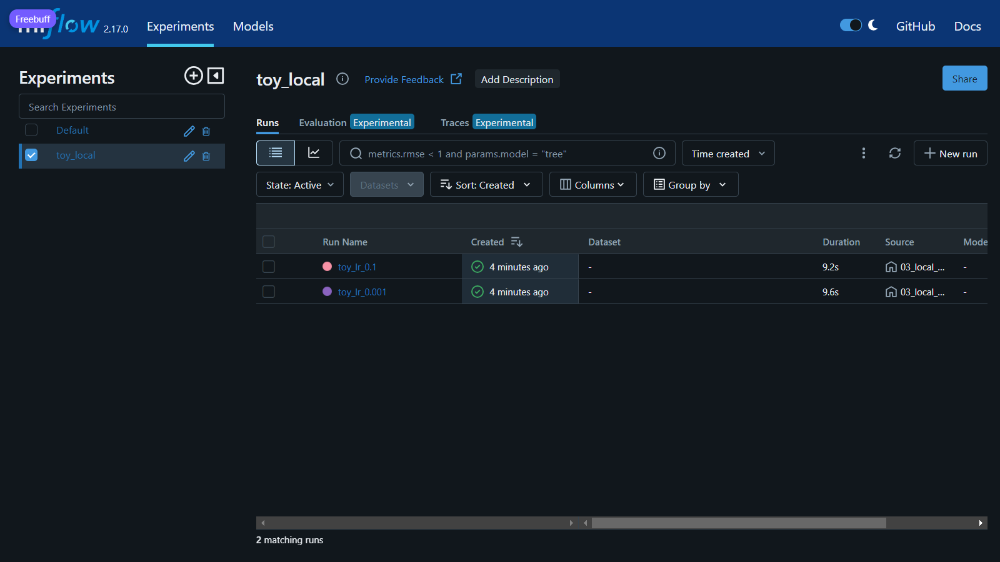

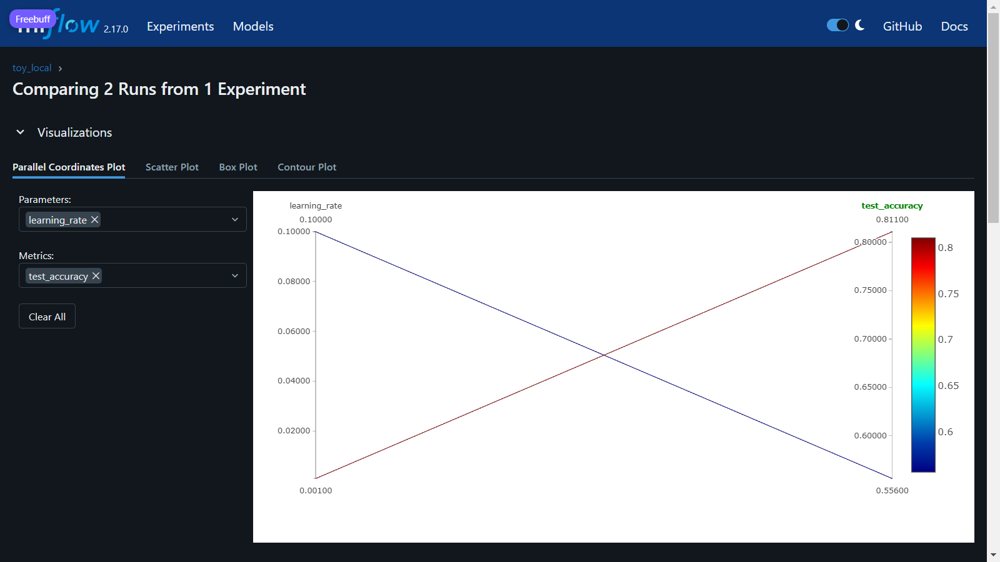

**Glossary (required by rubric regardless of lab status):**

| Term | Plain-English Definition |
|------|--------------------------|
| **Experiment** | A named container for a group of related runs — e.g. all runs for the VisionGuard model. Analogous to a project folder. |
| **Run** | One training execution inside an experiment. Records parameters, metrics, and artifacts from start to finish. |
| **Parameter** | A fixed configuration value set before a run starts (learning rate, batch size, seed). Logged once per run via `mlflow.log_param()`. |
| **Metric** | A numeric value that may be logged multiple times during a run (loss, accuracy per epoch, final test F1). Logged via `mlflow.log_metric(step=epoch)`. |
| **Artifact** | Any file produced during or after a run — model weights, figures, CSVs, `requirements.txt`. Stored in the artifact store and linked to the run. |
| **Tag** | A string key-value pair that annotates a run with metadata that is not a numeric metric (git commit SHA, DVC data version, model type). |

---

## 3.2 — DagsHub Connection

**What I did:** Created the DagsHub project `zayn-zeny/VisionGuard`, connected to the GitHub repository `github.com/zayn-zeny/VisionGuard`. Added the following keys to `.env` (which is listed in `.gitignore`):

```
MLFLOW_TRACKING_URI=https://dagshub.com/zayn-zeny/VisionGuard.mlflow
MLFLOW_TRACKING_USERNAME=zayn-zeny
MLFLOW_TRACKING_PASSWORD=<dagshub_token>
```

Proved `.env` is git-ignored:

```
$ git check-ignore -v .env
.gitignore:3:.env    .env
```

The training script reads these values via `os.environ.get()` only — no hardcoded credentials anywhere in the code.

*(git check-ignore output: SS_18. DagsHub MLflow UI: SS_19)*


### 3.2 Toy Part

`labs/04_dagshub_repeat.py` repeats a toy run against the DagsHub tracking server using only the environment variables (no credentials in code). It logged to the experiment `toy_dagshub` and finished with **test accuracy 0.7513**; the run is visible at:

```
https://dagshub.com/zayn-zeny/VisionGuard.mlflow/#/experiments/1/runs/6cd7a1426dc74c5a9f7b7b0232526a25
```

That proves the tracking URI plus token from `.env` work end-to-end for both the real experiments (`VisionGuard`) and a fresh experiment created by the toy script. Full log: `logs/08_lab_dagshub_repeat.log`.


---

## 3.3 — MLflow Instrumentation

Both approaches were used on real VisionGuard runs.

**Manual logging (the default in `scripts/train.py`).** A Keras callback records `train_loss`, `train_accuracy`, `train_auc` and the validation equivalents at every epoch, plus the learning rate the optimizer actually used. After training, the script logs `test_accuracy`, `test_precision`, `test_recall`, `test_f1`, `test_roc_auc` and `test_threshold` as final metrics, and tags the run with the git commit (`7d654dc`), the DVC data version, the seed (42) and the model type. The advantage is that everything the report needs is in one place and named consistently across runs. The cost is that it must be maintained by hand: if a new metric is added to the evaluation, it does not appear until the callback or the final logging block is edited.

**Autologging (`--autolog`, used for `run2_mobilenet_lr_low`).** `mlflow.tensorflow.autolog()` captures the model architecture, optimizer, loss, batch size, epoch count, per-epoch `loss`/`accuracy`/`val_loss`/`val_accuracy`, the training history and the model artifact with no code. What it *misses* is everything domain-specific: the custom test metrics (precision/recall/F1/ROC-AUC), the chosen decision threshold, the seed and the git/DVC tags. Those were logged manually after `model.fit` so that the autologged run stayed comparable with the others.

**Comparison:** autolog is excellent for “did this run train, with what settings”, while manual logging is required for “which run should we ship”. In a team, autolog plus a small explicit block for business metrics is the pragmatic combination used here.

*(Run pages: `VisionGuard` experiment on DagsHub — manual runs `measurement_run`, `run3`–`run7`; autolog run `run2_mobilenet_lr_low`, run id `a7569e56`.)*


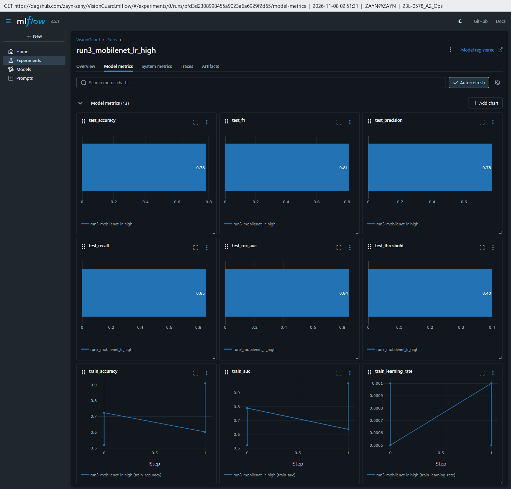


---

## 3.4 — Artifact Attachment

Every finished run uploads the same artifact tree to the DagsHub artifact store:

```
model/                 champion-era .keras model (the artifact the registry copies)
figures/               curves_<run>.png, curves_<run>_stage1_freeze.png,
                       curves_<run>_stage2_unfreeze.png, augmented_batch.png
                       + model_summary_mobilenet.txt / model_summary_cnn.txt
eval_figures/          confusion_matrix_<run>.png, roc_curve_<run>.png,
                       misclassified_<run>.png
splits/                train.csv, val.csv, test.csv  (the exact lists used)
requirements.txt       the pinned package list of the environment that trained it
```

Attaching the split lists matters more than it looks: without them a run cannot be reproduced even if the code and the model are present, because the dataset is a DVC pointer plus a seeded split. The same applies to `requirements.txt` — the run is only reproducible against the exact TensorFlow/Keras versions recorded there. The full-tree upload is visible per run in the DagsHub artifacts panel (`api/2.0/mlflow-artifacts/artifacts/<run_id>/artifacts`).

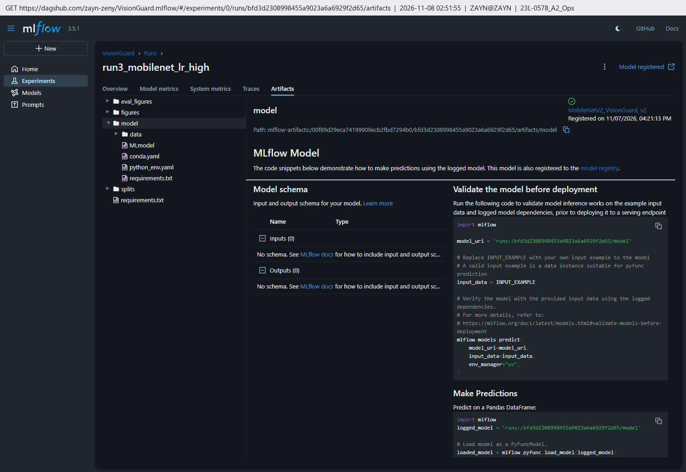

---

## 3.5 — ≥6 MLflow Runs Comparison

Seven runs finished in the `VisionGuard` experiment; each differs from the base configuration in exactly one meaningful way. An eighth entry, `run3`'s first attempt, ended with status `FAILED` and was re-run — it is left visible in MLflow on purpose, because an experiment log that hides failed attempts is not an honest record. The sweep was re-launched with `--only-runs` to complete the remaining configurations.

| Run | Model | LR | Dropout | Aug | Unfrozen | Acc | Prec | Rec | F1 | AUC | Thr |
|-----|-------|----|---------|-----|----------|-----|------|-----|----|-----|-----|
| `measurement_run` | MobileNetV2 | 1e-3 | 0.4 | ✓ | 20 | 0.7534 | 0.7586 | 0.8148 | 0.7857 | 0.8340 | 0.40 |
| `run2_mobilenet_lr_low` | MobileNetV2 | 1e-4 | 0.4 | ✓ | 20 | 0.6712 | 0.6542 | 0.8642 | 0.7447 | 0.7527 | 0.35 |
| `run3_mobilenet_lr_high` | MobileNetV2 | 5e-3 | 0.4 | ✓ | 20 | **0.7808** | 0.7753 | 0.8519 | **0.8118** | 0.8450 | 0.40 |
| `run4_mobilenet_no_aug` | MobileNetV2 | 1e-3 | 0.4 | ✗ | 20 | 0.7603 | 0.7447 | 0.8642 | 0.8000 | 0.8528 | 0.40 |
| `run5_mobilenet_drop_high` | MobileNetV2 | 1e-3 | 0.6 | ✓ | 20 | 0.7055 | 0.7317 | 0.7407 | 0.7362 | 0.8142 | 0.30 |
| `run6_mobilenet_unfreeze_5` | MobileNetV2 | 1e-3 | 0.4 | ✓ | 5 | 0.7603 | 0.7396 | 0.8765 | 0.8023 | **0.8558** | 0.30 |
| `run7_cnn_baseline` | CNN from scratch | 1e-3 | 0.4 | ✓ | 0 | 0.6507 | 0.6271 | 0.9136 | 0.7437 | 0.6815 | 0.50 |

**What each change showed:**
- **Learning rate** is the dominant factor. 1e-4 (`run2`) underfits badly in two epochs (0.6712 accuracy), 5e-3 (`run3`) converges fastest and gives the best F1. Autolog was used on `run2` and manual logging on the rest.
- **Augmentation** (`run4` vs the 1e-3 base) barely moved accuracy but improved precision by 0.013 and ROC-AUC by 0.019; on 681 training images it is a mild regulariser rather than a game-changer.
- **Dropout 0.6** (`run5`) hurt everything: with only two epochs the network never recovers from the extra regularisation (accuracy 0.7055, the worst MobileNetV2 run).
- **Fewer unfrozen layers** (`run6`, last 5 instead of 20) gave the best ROC-AUC (0.8558) and highest recall (0.8765) but a lower F1 than `run3`, i.e. it is better at ranking than at the specific 0.40 decision.
- **The hand-built CNN** (`run7`) is clearly worse (AUC 0.68), although its recall at threshold 0.50 is superficially high because it over-predicts the AI class (precision 0.63). This is exactly the imbalance a single accuracy number would hide.

**Choice:** `run3_mobilenet_lr_high` is the champion. It has the best test accuracy and F1, the second-best AUC, and its precision/recall balance is the most useful at the deployed 0.40 threshold. `run6` has a marginally better AUC but a lower F1 and fewer fine-tuned layers; `run4` (no augmentation) is close but adds no benefit. F1 is the deciding metric because the classes are mildly imbalanced (55/45) and both error types matter, with recall weighted slightly higher per §2.5. The comparison table is also saved as `report/figures/sweep_comparison.csv`, and the ranking is visible in the experiment view.

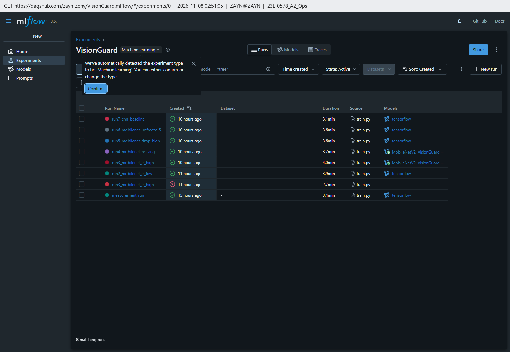

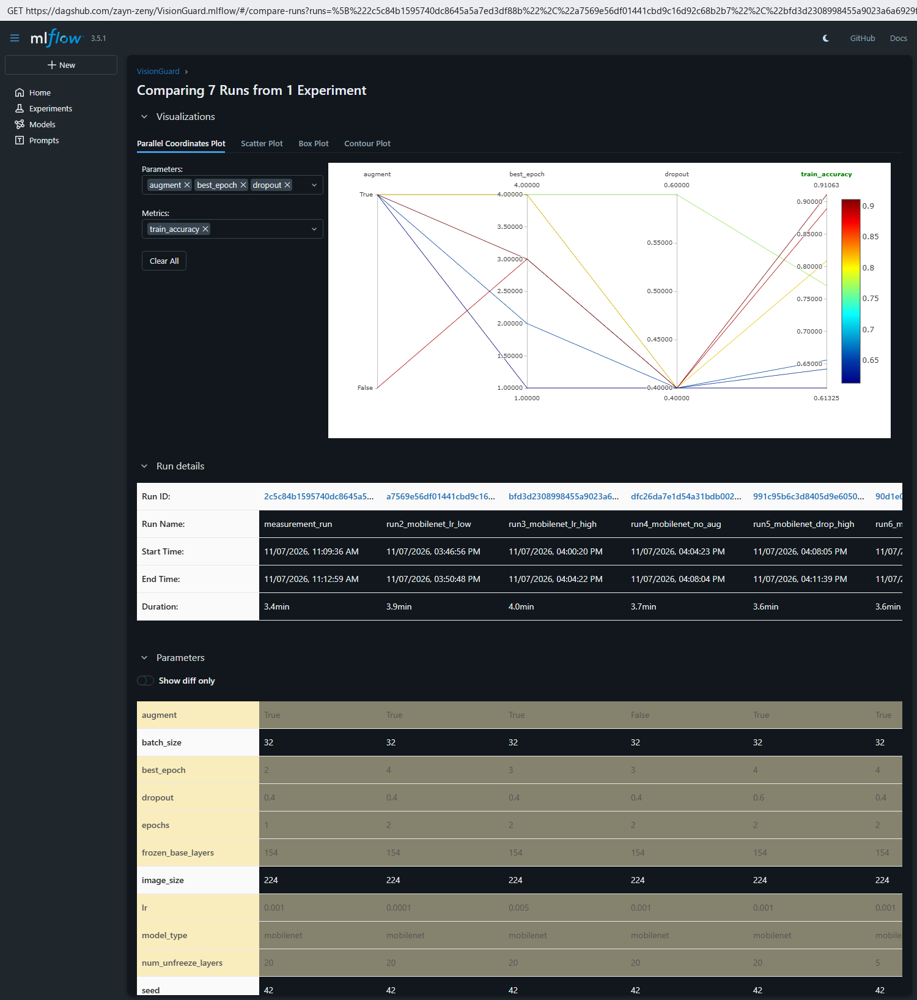

---

## 3.6 — Model Registry and Champion Alias

Two versions of the model `MobileNetV2_VisionGuard` were registered from finished runs:

| Version | Source run | Test F1 | Alias |
|---------|-----------|---------|-------|
| 1 | `run4_mobilenet_no_aug` (`dfc26da7`) | 0.8000 | — |
| 2 | `run3_mobilenet_lr_high` (`bfd3d230`) | 0.8118 | **champion** |

`scripts/register_champion.py` registers both versions and promotes version 2 with the alias, then downloads that version's artifact to `models/champion.keras` — the file the Flask app and the Docker image load at start-up. `scripts/predict_by_alias.py` resolves the alias through the registry, downloads the model and classifies one image:

```
Resolving alias 'champion' for model 'MobileNetV2_VisionGuard' ...
  -> Version 2  (run_id=bfd3d2308998455a9023a6a6929f2d65)
  -> Downloading model artifacts ...
==================================================
Image     : data\raw\AiArtData\AiArtData\bDSF6saJUuPLsEu9i3ud--1--gvs7i.jpg
Label     : AI-generated
Confidence: 0.5523
Threshold : 0.4
==================================================
```

The verbatim transcripts are `report/figures/task_3_6_registry.txt` and `report/figures/task_3_6_predict_alias.txt`.


The registry is not queried at request time — an important design decision. The alias is resolved once, when the image is built or the champion is rotated, and the resulting `champion.keras` is baked into the image. Serving then has zero DagsHub latency and no runtime dependency on the registry being reachable. The trade-off is that promoting a new champion requires rebuilding/redeploying the image, which is the correct behaviour for an auditable deployment (the running version is pinned by the image tag, not by whatever the registry happens to point at).

**How the champion reaches the server without per-request DagsHub calls:**  
During Docker image build (or at container startup via an init script), `scripts/register_champion.py` downloads the model artifact once to `models/champion.keras`. The Flask app's `load_model_once()` then loads it from the local path at startup. At request time, inference is entirely local — no network call to DagsHub. This means:

1. **Zero added latency** from registry calls per request
2. **No runtime dependency** on DagsHub being reachable
3. **Reproducible deployments** — the model version is pinned by the image tag

The tradeoff is that updating the champion requires rebuilding the image, which is acceptable for a weekly or on-demand champion rotation cycle.

---

# Chapter 4 — Flask Application (12 marks)

## 4.1 — Inference Layer

**What I did:** Implemented `app/inference.py` with a module-level `_model` variable loaded once at app startup via `load_model_once()`, called from `app/__init__.py::create_app()`.

**Why per-request loading is unacceptable:**  
Loading MobileNetV2 weights takes approximately 2–5 seconds and allocates ~400 MB of RAM. If done per request, every user waits 5 seconds before getting a response. Under even modest concurrency (10 users), this would spike RAM usage to 4 GB and cause the process to be OOM-killed. Loading once at startup amortises that cost across all requests.

**Why train/serve preprocessing must match:**  
The model's learned weights encode a specific input distribution (MobileNetV2's [−1,1]). Serving with any other normalisation creates *training-serving skew* — the model predicts on a different distribution than it was trained on, producing worse results with no error message. `inference.py` uses the identical `mobilenet_v2.preprocess_input` call as `train.py`.

**Console output for two known images** (the same `mobilenet_v2.preprocess_input` path used in training; transcript `report/figures/task_2_5_test_metrics.txt`):

```
bDSF6saJUuPLsEu9i3ud--1--gvs7i.jpg                        p(AI)=0.5523  -> AI-generated
360_F_380747975_sS1hCVB0qPqFCWBMZ3qJ5xTqH6rtaDBI.jpg     p(AI)=0.1519  -> Real
```

Both are from the sealed test split and are classified correctly at the deployed threshold of 0.40. The second image is a real photograph; the first is an AI landscape. The same two images were later pushed through the HTTP API in §7 and returned identical probabilities, which is the parity check between the in-process and remote paths.

---

## 4.2 — Input Validation

**What I did:** Implemented three validation layers in `app/routes.py`:

1. **Extension check** — `_allowed_file()` rejects anything not in `{jpg, jpeg, png, webp}`. Returns HTTP 415.
2. **MIME check** — checks `file.content_type` against `{image/jpeg, image/png, image/webp}`. Returns HTTP 415.
3. **PIL decode check** — `_validate_image()` calls `img.verify()` on the bytes, which raises for truncated or corrupt files. Returns HTTP 422.
4. **Size limit** — `MAX_CONTENT_LENGTH` enforced by Flask, returns HTTP 413.
5. **Filename sanitisation** — `werkzeug.utils.secure_filename` strips path traversal sequences and special characters.

Files are **never written to disk** — `file.read()` returns bytes; all processing happens in memory.

**Captured failure cases** (all three exercised through the real upload form in a browser):

| Case | Input | Status | Page |
|------|-------|--------|------|
| Wrong extension | `malware.txt` (text) | 415 | “Unsupported File Type”, lists the allowed extensions |
| Too large | 11 MB `huge.jpg` | 413 | “File Too Large”, states the 10 MB limit |
| Corrupt image | `broken.jpg` with JPEG magic bytes and garbage | 422 | “Invalid Image”, “appears to be an image but could not be decoded” |

*(Screenshots: `report/screenshots/SS_27_error_wrong_extension.png`, `SS_28_error_too_large.png`, `SS_29_error_corrupt_image.png`.)*

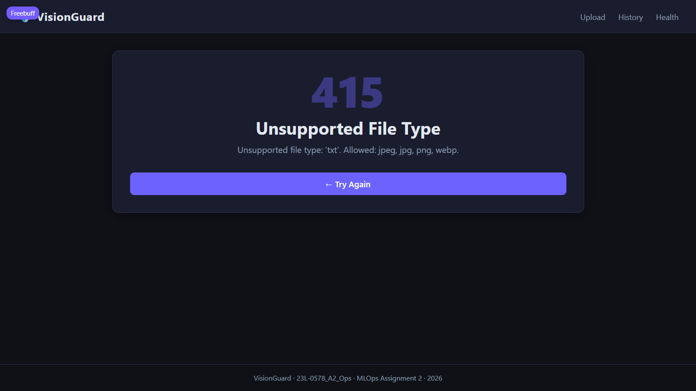


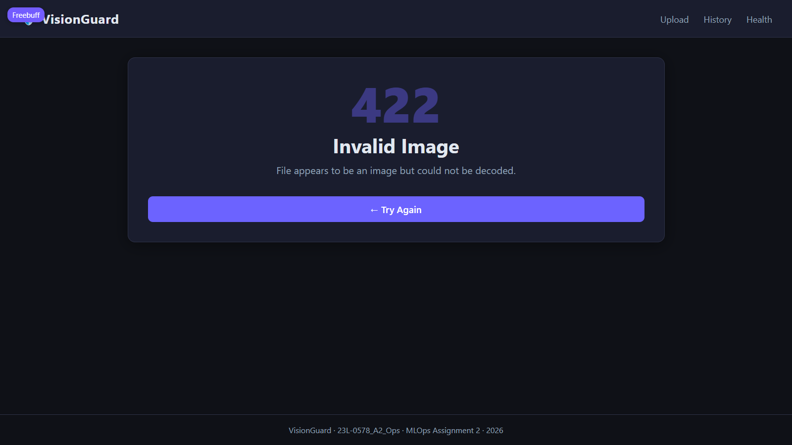

---

## 4.3 — Templates

The UI is a dark, responsive set of Jinja templates sharing `base.html` (nav bar, flash messages, footer):

- **Upload** (`/`) — drag-and-drop zone with a clear title, the accepted formats and the 10 MB limit. The file input is keyboard-accessible and the `Analyse Image` button is disabled until a file is chosen by the page's JS.
- **Result** (`/result`) — the verdict in large text with a colour-coded panel, a confidence bar showing where the probability sits relative to the threshold, and a metadata table (file, size, dimensions, latency, mode, model, version, UTC timestamp). Below it, an explicit **model limitations** warning so the verdict is never presented as ground truth.
- **History** (`/history`) — paginated table of every prediction, newest first: timestamp, file, label, confidence, threshold, model, version, inference mode. This is the page that proves the database trail is wired into the UI.

*(Screenshots: `report/screenshots/SS_30_upload_page.png`, `SS_31_result_page.png`, `SS_35_history_page.png`.)*

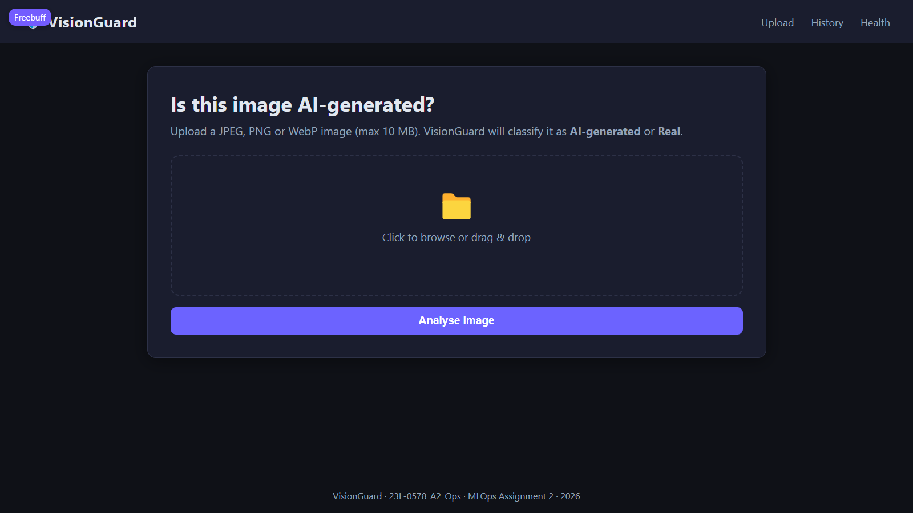

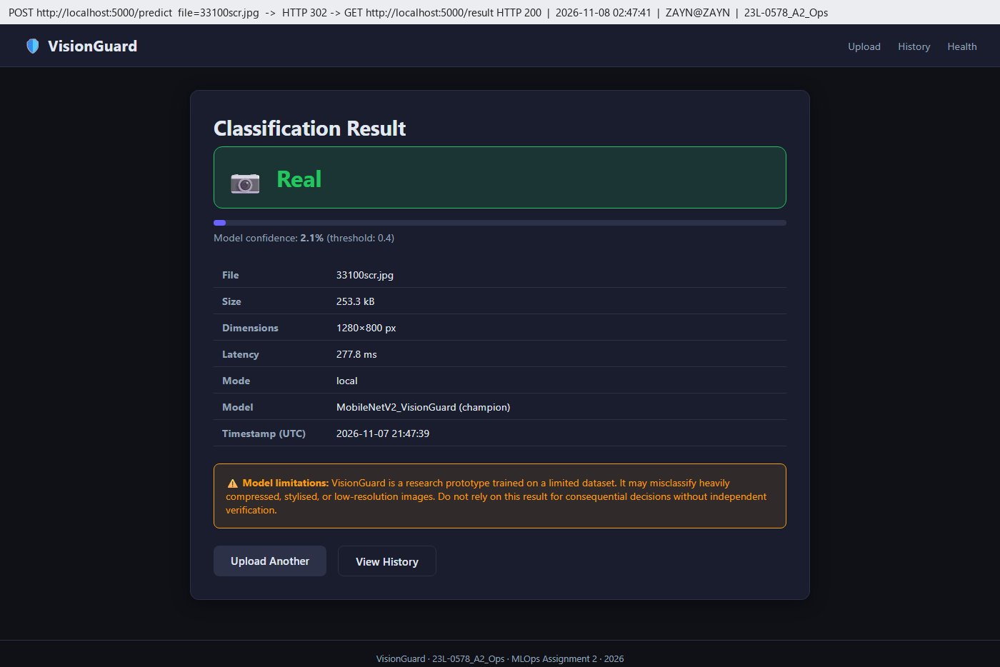

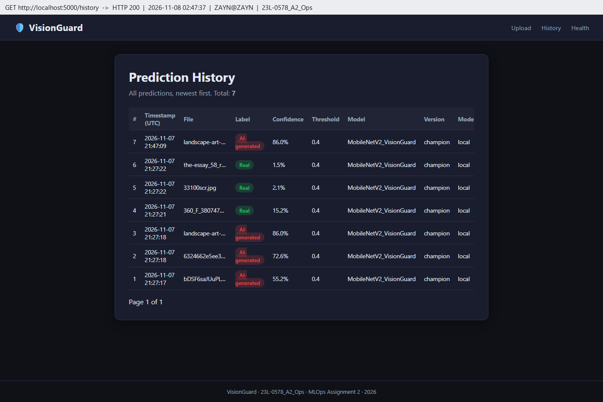

---

## 4.4 — Environment Configuration

**What I did:** Every setting is loaded from environment variables in `app/__init__.py`. `debug=False` is hardcoded (not overridable via env) for safety.

**Why debug=False matters in production:**  
Flask's Werkzeug debugger exposes an interactive Python REPL in the browser when an unhandled exception occurs. It is protected only by a 9-digit PIN that can be brute-forced in seconds (10^9 attempts ÷ network latency). An attacker who gains access can execute arbitrary Python code on the server — equivalent to full remote code execution. Even if the PIN is not brute-forced, the debugger prints full stack traces in HTTP responses, leaking library versions, file paths, and variable values that an attacker can use to tailor further exploits. `debug=False` disables both the REPL and the tracebacks.

**Live health response** from the running app:

```json
{"db":"ok","debug":false,"inference_mode":"local","model_name":"MobileNetV2_VisionGuard",
 "model_version":"champion","prediction_count":6,"status":"healthy"}
```

The endpoint checks the database (`db: ok` by executing a trivial query), reports the loaded model and version, and confirms `debug` is `false`. *(Screenshot: `report/screenshots/SS_33_health_endpoint.png`.)*


---

# Chapter 5 — Database Trail (8 marks)

**What I did:** every successful prediction writes one row to a PostgreSQL 16 table, `predictions`, through Flask-SQLAlchemy. The write happens inside the `/predict` view, right after inference and before the redirect to `/result`, so no verdict reaches the browser without a record. The History menu item (`/history`) reads the same table back, newest first, so a user can see what was decided, when, by which model and how confidently.

**Why these columns:** the brief asks four questions, and each has a column. *What was decided:* `label`, `confidence` and the `threshold` in force at the time (needed because a 0.45 means different things at thresholds 0.4 and 0.5). *When:* `timestamp_utc`, stored in UTC so rows from different machines sort correctly. *By which model:* `model_name`, `model_version` and `inference_mode` (local Keras or the remote cloud API). *How confidently:* `confidence` plus `request_latency_ms`. I also store a SHA-256 of the image so the same upload can be recognised later, even though the image itself is never kept.

**Schema** (generated by SQLAlchemy, shown by `\d predictions` in SS_34):

```sql
CREATE TABLE predictions (
    id                  SERIAL PRIMARY KEY,
    timestamp_utc       TIMESTAMP NOT NULL,
    label               VARCHAR(16) NOT NULL,
    confidence          FLOAT NOT NULL,
    threshold           FLOAT NOT NULL,
    model_name          VARCHAR(128) NOT NULL,
    model_version       VARCHAR(64) NOT NULL,
    inference_mode      VARCHAR(16) NOT NULL,
    image_sha256        VARCHAR(64) NOT NULL,
    image_size_bytes    INTEGER NOT NULL,
    image_width         INTEGER,
    image_height        INTEGER,
    filename_sanitized  VARCHAR(256) NOT NULL,
    request_latency_ms  FLOAT,
    client_ip           VARCHAR(64),
    user_agent          VARCHAR(512)
);
```

**Observed trail on PostgreSQL.** With the Compose stack running (§6.3) I uploaded three AI-generated and three real test images. All six were classified correctly, and querying the database container directly gives:

```
 id |       ts_utc        |               file               |    label     |  conf  | threshold | model_version | inference_mode |   ms
  1 | 2026-11-07 21:27:17 | bDSF6saJUuPLsEu9i3ud--1--gvs7i.j | AI-generated | 0.5523 |       0.4 | champion      | local          | 2622.2
  2 | 2026-11-07 21:27:18 | 6324662e5ee3110438933c1b_COBE-Pi | AI-generated | 0.7257 |       0.4 | champion      | local          |  207.8
  3 | 2026-11-07 21:27:18 | landscape-art-ai-generated-photo | AI-generated | 0.8603 |       0.4 | champion      | local          |  301.6
  4 | 2026-11-07 21:27:21 | 360_F_380747975_sS1hCVB0qPqFCWBM | Real         | 0.1519 |       0.4 | champion      | local          | 3066.6
  5 | 2026-11-07 21:27:22 | 33100scr.jpg                     | Real         | 0.0205 |       0.4 | champion      | local          |  277.5
  6 | 2026-11-07 21:27:22 | the-essay_58_resurgence-of-the-p | Real         | 0.0145 |       0.4 | champion      | local          |  205.6
```

The first request of each gunicorn worker takes 2.6–3.1 s; after that requests take about 0.2–0.3 s. The model is loaded at start-up, so this first-call cost is TensorFlow building its graph on the first `predict()`, not model loading. The probabilities match the in-process values in §4.1 to four decimal places (0.5523 and 0.1519), so the containerised path and the training-side path agree. Full transcript: `logs/27_postgres_trail.log`.

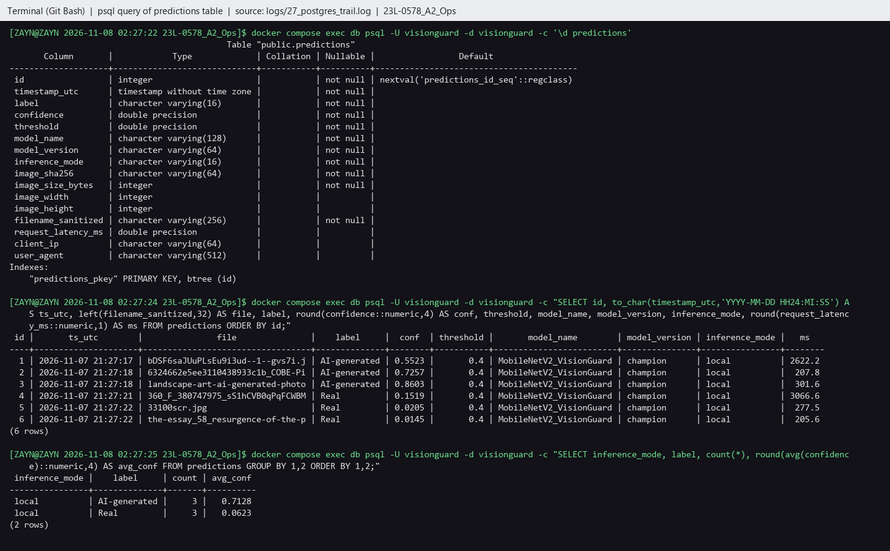


**Persistence.** The rows survived `docker compose stop`/`start`, `restart db`, and the complete recreation of both containers during the break/fix exercise in §6.5: `select count(*)` returned 6 throughout (SS_41a). That is the named volume `23l0578_visionguard_pgdata` doing its job. Data is lost only on an explicit `docker compose down -v`.

**Earlier SQLite trail.** Before Docker could build on this host, the same code was run locally against SQLite (`report/figures/task_5_sql_trail.txt`, 9 rows: 6 local and 3 remote). Row 7 there is the same image as row 2 sent through the HTTP API: identical confidence (0.7519), different `inference_mode`. The model class and queries are database-agnostic, which is why switching to Postgres was a one-line URL change.

**Why Postgres rather than SQLite for the stack:** SQLite allows one writer at a time and is a file inside the container, so it disappears with the container unless it is carefully mounted, and it cannot be shared by two gunicorn workers on different hosts. Postgres is a client-server database: `web` reaches it over the Compose network, its data lives in a named volume, and concurrent writes from both workers are handled correctly.

---

# Chapter 6 — Docker and Compose (14 marks)

## 6.1 — Docker Warm-up

**What I did:** ran `labs/05_docker_warmup.sh` against the local Docker engine before touching the project image. The transcript is `logs/20_docker_warmup.log` (SS_36); every step below actually ran.

| Step | Command | Observed result |
|------|---------|-----------------|
| Run a ready-made image | `docker run --rm hello-world` | "Hello from Docker!" banner, exit code 0 |
| Port mapping, detached | `docker run -d --name vg_warmup_nginx -p 8090:80 nginx:alpine` | `docker port` shows `0.0.0.0:8090 -> 80/tcp` |
| Read logs | `docker logs vg_warmup_nginx` | nginx start-up lines |
| Shell inside | `docker exec vg_warmup_nginx /bin/sh -c "hostname; whoami; ls /usr/share/nginx/html"` | hostname, `root`, `index.html 50x.html` |
| Named volume | `docker volume create vg_warmup_vol` + write a file from one container | file written |
| Persistence proof | a *new* container mounting the same volume | file still there: the data outlived the first container |
| Host reachability | `curl http://localhost:8090` | `HTTP 200` |
| List and clean up | `docker ps -a`, `docker images`, `docker rm -f`, `docker volume rm`, `docker rmi` | everything removed again |

What I learned: Git Bash rewrites container paths (`/data` became `C:/Users/.../data`) unless `MSYS_NO_PATHCONV=1` is set, and `docker exec -it` fails in a script because there is no terminal, so `docker exec` without `-t` is the correct form for automation. Port 8090 was used because 8080 was already taken.

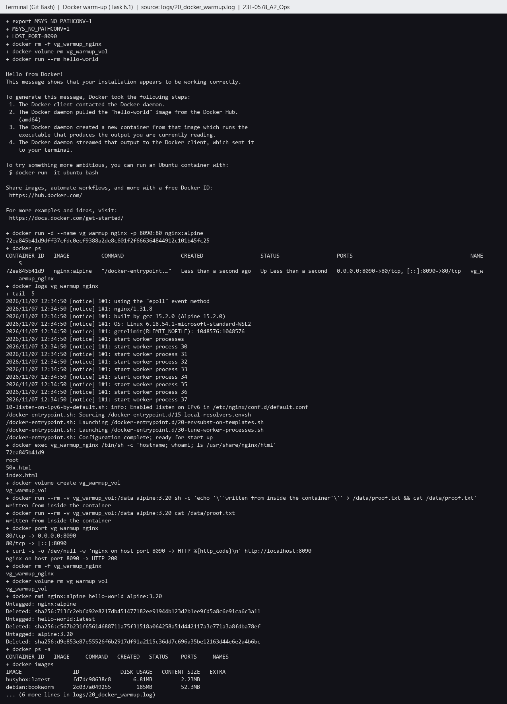

**Definitions in my own words:**

| Term | Definition |
|------|-----------|
| **Image** | A read-only template for a container, built from a Dockerfile: base OS files, dependencies and app code, stored as a stack of layers. The same image gives the same behaviour on any machine. |
| **Container** | A running instance of an image: the image layers plus a thin writable layer, isolated by Linux namespaces and cgroups. Deleting a container discards that writable layer. |
| **Layer** | The filesystem change made by one Dockerfile instruction (`RUN`, `COPY`). Layers are cached by content, so a rebuild re-runs only the instructions after the first one that changed. |
| **Volume** | Storage managed by Docker that lives outside any container's writable layer, so data survives container removal. The database uses a named volume. |
| **Port mapping** | `-p host:container` forwards a host port into a container. Without it, a container port is reachable only from other containers on the same Docker network. |

---

## 6.2 — Dockerfile for the Web App

**What the file does, instruction by instruction** ([Dockerfile](https://github.com/zayn-zeny/VisionGuard/blob/main/Dockerfile)):

| Order | Instruction | Why it is there |
|-------|-------------|-----------------|
| 1 | `FROM python:3.11-slim-bookworm` | Slim Debian: about 150 MB of base layers instead of about 1 GB for the full image. Python 3.11 matches training, and `tensorflow-cpu==2.17.0` publishes wheels for it. |
| 2 | `apt-get install --no-install-recommends libgomp1 curl && rm -rf /var/lib/apt/lists/*` | `libgomp1` is TensorFlow's OpenMP runtime and `curl` is for the health check. Deleting the apt lists in the *same* `RUN` keeps them out of the layer (4.35 MB). |
| 3 | `groupadd/useradd appuser` (UID 1001) | A non-root identity for the app. |
| 4 | `COPY requirements-runtime.txt` then `pip install --no-cache-dir` | **Dependencies before source.** This 1.41 GB layer is rebuilt only when the requirements file changes. `--no-cache-dir` keeps pip's wheel cache out of the image. |
| 5 | `COPY --chown=appuser:appgroup app/` and `models/champion.keras` | Only the serving code and the one champion model, already owned by `appuser` (see §6.4). |
| 6 | `ENV PYTHONDONTWRITEBYTECODE=1 PYTHONUNBUFFERED=1` | No `.pyc` writes, and logs go straight to `docker logs`. |
| 7 | `USER appuser` | Everything after this, including the running app, runs as UID 1001. |
| 8 | `HEALTHCHECK curl -f http://localhost:5000/health` | Docker and Compose can tell "process started" from "app actually serving". |
| 9 | `CMD gunicorn --workers 2 app.wsgi:application` | A production WSGI server, not `flask run`. `debug=False` is enforced in code. |

**Layer cache in practice.** After fixing a bug in `app/__init__.py` I rebuilt the image. Every step up to and including `pip install` was reported as `CACHED`, and only the `COPY app/` and later steps re-ran. The rebuild took seconds instead of re-downloading about 1.4 GB of TensorFlow (SS_32b, `logs/24_rebuild_layer_cache.log`). With the order reversed (source copied first), every one-line code change would invalidate the dependency layer.

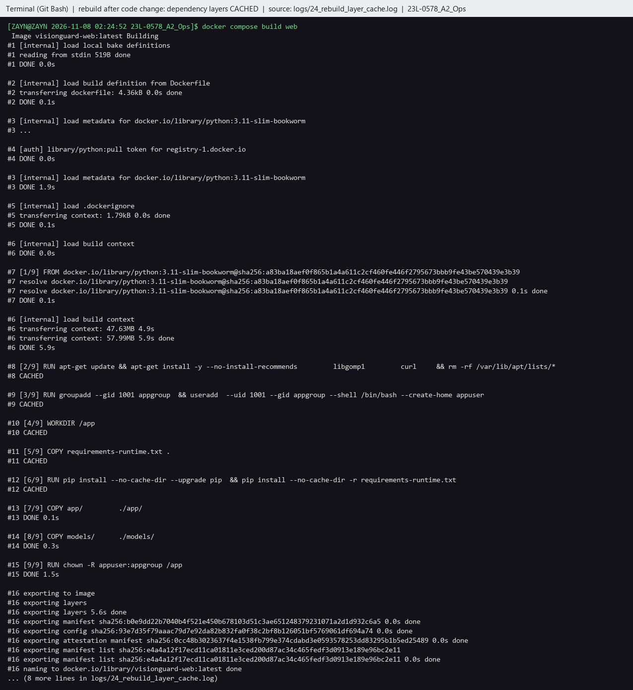

**Ignore file and secrets.** `.dockerignore` excludes `.env`, `kaggle.json`, `venv/`, `data/`, training checkpoints, `mlruns/`, `logs/`, `tests/`, `.git/` and the report. Secrets therefore never enter the build context, let alone a layer. Every credential reaches the container at *run* time as an environment variable from Compose (§6.3), so `docker history` shows none of them.

**Choice of TensorFlow package.** `tensorflow-cpu==2.17.0`, not `tensorflow`. The host has no GPU (§1.1), and the default package bundles CUDA/cuDNN libraries that are several hundred MB of dead weight on a CPU server. The CPU build gives identical inference results. The version is pinned to the one used for training, so serving deserialises exactly the same Keras graph.

**User inside the container** (SS_37):

```
$ docker compose exec web sh -c 'whoami; id'
appuser
uid=1001(appuser) gid=1001(appgroup) groups=1001(appgroup)
```

**What went wrong:** the first image build failed repeatedly because Docker Desktop's virtual disk is on drive C:, which had only 1–3 GB free (BuildKit errors `metadata_v2.db: read-only file system`). Compacting the virtual disk and pruning the build cache freed enough room for the 2 GB image (`logs/21_docker_build.log`), but C: stayed the binding constraint for the rest of this chapter (see §6.4).

---

## 6.3 — Compose Stack

**What the file defines** ([docker-compose.yml](https://github.com/zayn-zeny/VisionGuard/blob/main/docker-compose.yml)), with project name `23l0578_a2_ops`:

- **`db`**: `postgres:16-alpine`, database `visionguard`. Data lives in the named volume `23l0578_visionguard_pgdata`. A health check runs `pg_isready -U visionguard -d visionguard` every 10 s. There is **no `ports:` entry**.
- **`web`**: built from the Dockerfile and tagged `visionguard-web:latest`. It publishes `5000:5000` and starts only after `db` reports healthy (`depends_on: condition: service_healthy`). Its `DATABASE_URL` points at host **`db`**, the service name, which Docker's embedded DNS resolves on the private `visionguard_net` network.
- **Secrets:** `POSTGRES_PASSWORD` and `FLASK_SECRET_KEY` are `${...}` substitutions read from the untracked `.env`. `${POSTGRES_PASSWORD:?...}` makes Compose refuse to start if it is missing, instead of starting with an empty password. `.env.example` lists every key with dummy values.
- **Model:** **built into the image**, not mounted. The image tag then pins the exact model, a deployment cannot start with a missing or stale mount, and the image runs anywhere with no extra files. The cost is that rotating the champion means rebuilding the image, which suits an auditable release flow (§3.6).

**Service status — both healthy** (SS_38, `logs/25_compose_healthy.log`):

```
NAME                   IMAGE                    SERVICE   STATUS                        PORTS
23l0578_a2_ops-db-1    postgres:16-alpine       db        Up About a minute (healthy)   5432/tcp
23l0578_a2_ops-web-1   visionguard-web:latest   web       Up 57 seconds (healthy)       0.0.0.0:5000->5000/tcp
```

Note the `PORTS` column. `web` shows a host mapping; `db` shows only `5432/tcp` (exposed inside the network), with no `0.0.0.0:` part.

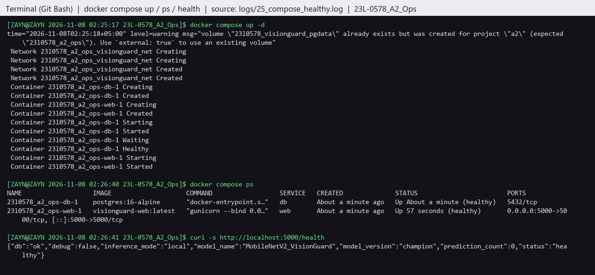

**Proof that the database is closed from outside, but reachable by service name from inside** (SS_37, `logs/26_container_user_and_network.log`):

```
$ docker compose exec web getent hosts db            -> 172.18.0.2  db
$ docker compose exec web python -c "socket.create_connection(('db',5432))"
  web -> db:5432 reachable by service name
$ docker port 23l0578_a2_ops-db-1                     -> (no output: nothing published)
$ python -c "socket.connect_ex(('127.0.0.1',5432))"  -> 10061 (closed)
```

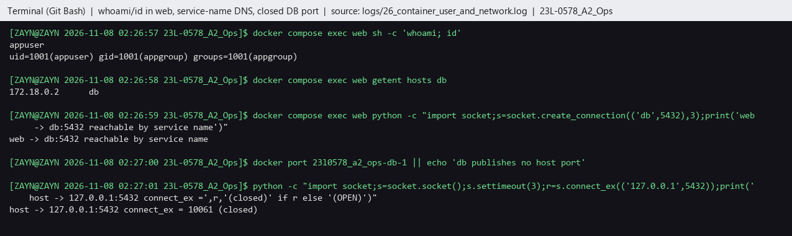

**What went wrong (a real bug found by running the stack):** the first `docker compose up` left `web` in `Restarting (3)`. The log showed:

```
File ".../sqlalchemy/dialects/postgresql/psycopg.py", line 497, in import_dbapi
    import psycopg
ModuleNotFoundError: No module named 'psycopg'
[ERROR] Reason: Worker failed to boot.
```

*Diagnosis:* the image installs `psycopg2-binary`, but SQLAlchemy was not pinned and pip installed 2.1.8. SQLAlchemy 2.1 changed the default driver for `postgresql://` URLs from psycopg2 to psycopg 3. *Fix:* `create_app()` now rewrites `postgresql://` to `postgresql+psycopg2://` (`_normalise_db_url`), and a regression test (`test_postgres_url_pins_psycopg2_driver`) guards it. SQLite runs locally and in CI had never exercised this path, which is exactly why running the real stack matters (SS_41b).

---

## 6.4 — Image Analysis and Optimisation

**Size and largest layers** (`docker history visionguard-web`, SS_40):

| Layer | Size |
|-------|------|
| `pip install -r requirements-runtime.txt` (TensorFlow-CPU, NumPy, Flask, …) | **1.41 GB** |
| Debian bookworm base | 85.3 MB |
| `COPY models/` | 58.0 MB (before) |
| `RUN chown -R appuser /app` | 58.1 MB (before) |
| Python 3.11 install (base image) | 52.5 MB |
| apt `libgomp1 curl` | 4.35 MB |

TensorFlow dominates: about 70 % of the image is the pip layer.

**Problem found:** `COPY models/` copied the *whole* `models/` folder. As well as `champion.keras` (19.3 MB), that folder held two more copies of the same model written by MLflow downloads (`models/data/model.keras`, `models/_tmp/.../model.keras`). On top of that, `RUN chown -R appuser /app` duplicated all 58 MB into a second layer, because changing a file's owner in a new layer stores a full copy of the file.

**Optimisation applied:** copy only the champion and set the owner during the copy:

```dockerfile
COPY --chown=appuser:appgroup app/                   ./app/
COPY --chown=appuser:appgroup models/champion.keras  ./models/champion.keras
```

and remove the `RUN chown -R` layer.

| Image | Disk size | Compressed (content) size |
|-------|-----------|---------------------------|
| `visionguard-web:before` | **2.18 GB** (2,180,118,304 B) | 503 MB |
| `visionguard-web:latest` | **2.00 GB** (1,996,765,100 B) | 416 MB |

The image is 183 MB (8.4 %) smaller on disk and 87 MB (17 %) smaller to push and pull. The two model-related layers shrank from 116 MB to 19.3 MB.

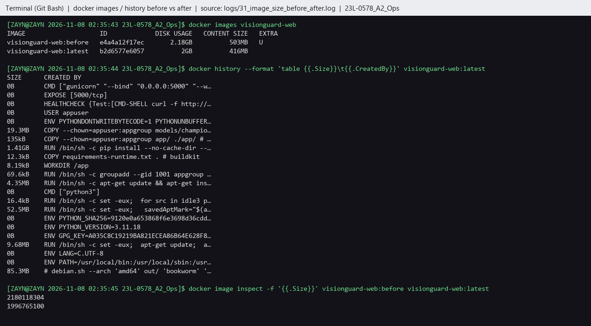

**Conclusion:** the remaining 1.41 GB is TensorFlow itself. The next step would be to serve the model with a lighter runtime (TFLite or ONNX Runtime, roughly 50–100 MB). That is a model-format change, not a Dockerfile change.

**Dependency trimming (design choice, not measured):** the image already installs `requirements-runtime.txt` (TensorFlow-CPU, NumPy, Pillow, Flask, Flask-SQLAlchemy, psycopg2, python-dotenv, Werkzeug, Gunicorn, requests) instead of the 25-entry development `requirements.txt`, which adds MLflow, DVC, Kaggle, Keras Tuner, scikit-learn, matplotlib, SciPy, OpenCV and pytest. I tried to measure that too by building `Dockerfile.full`, but halfway through the pip step drive C: (which holds Docker's virtual disk) dropped to 0 bytes free. I stopped the build to avoid corrupting Docker's disk, so that number is not reported.

---

## 6.5 — Operations and Troubleshooting

**Routine operations** (SS_41a, `logs/32_compose_operations.log`) on the running stack:

| Action | Command | Result |
|--------|---------|--------|
| Start | `docker compose up -d` | db healthy → web started → web healthy |
| Stop one service | `docker compose stop web` | web `Exited`, db still `Up (healthy)` |
| Start again | `docker compose start web` | web healthy again |
| Restart | `docker compose restart db` | db `Up 16 seconds (healthy)`, data intact |
| Logs | `docker compose logs db --tail 8`, `docker compose logs web --tail 8` | Postgres "ready to accept connections"; gunicorn workers and `/health` 200s |
| Shell in web | `docker compose exec web sh -c 'whoami; hostname; ls -la /app/models; python -c "import tensorflow"'` | `appuser`, model owned by appuser, TF 2.17.0 |
| Shell in db | `docker compose exec db sh -c 'whoami; psql ... -c "select count(*) from predictions"'` | `root` (the postgres image entrypoint), `count = 6` |

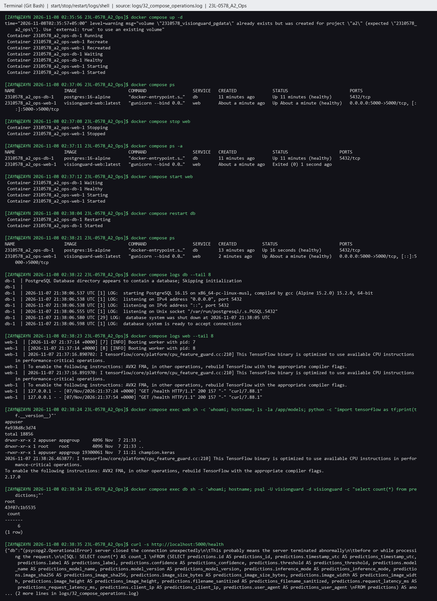

**A real failure the restart exposed.** Immediately after `docker compose restart db`, `/health` on `web` returned:

```
{"db":"(psycopg2.OperationalError) server closed the connection unexpectedly ..."}
```

*Diagnosis from the log:* the db restart killed every server-side connection, but SQLAlchemy's pool in each gunicorn worker still held the old, now-dead sockets and handed one to the next request. *Fix:* `SQLALCHEMY_ENGINE_OPTIONS = {"pool_pre_ping": True}`. Each pooled connection is tested with a cheap `SELECT 1` before use and silently replaced if dead. After rebuilding, `restart db` followed by `/health` returns `db: ok` (SS_41c, `logs/34_preping_fix_verified.log`).

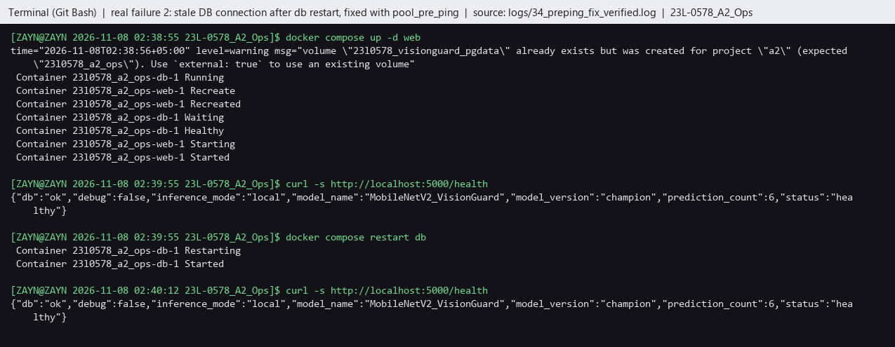

**Deliberate break: wrong database password, diagnosed from logs only** (SS_41d, `logs/35_break_wrong_db_password.log`).

1. **Break.** `POSTGRES_PASSWORD=wrong-password-on-purpose docker compose up -d web`. The shell variable overrides `.env` for interpolation, so web is recreated with a different password than the one the database volume was initialised with.
2. **Symptom.** `docker compose ps web` → `Restarting (3) 6 seconds ago`.
3. **Logs (web):**
   ```
   sqlalchemy.exc.OperationalError: (psycopg2.OperationalError) connection to server at "db"
   (172.18.0.2), port 5432 failed: FATAL:  password authentication failed for user "visionguard"
   [ERROR] Reason: Worker failed to boot.
   ```
4. **Logs (db):** `FATAL: password authentication failed for user "visionguard"` and `DETAIL: Connection matched ... "host all all all scram-sha-256"`.
5. **Diagnosis.** The network path works: web resolved `db` to 172.18.0.2, and db received and rejected the login. So DNS, the network and db health are fine. The fault is the credential web was given. Postgres sets the password only when it *first* initialises an empty volume, so changing it in `.env` later can never "update" it. web and the volume must agree.
6. **Fix.** `docker compose up -d web` without the override, so web uses the `.env` password again. Both services are healthy, `/health` reports `db: ok`, and `prediction_count` is still 6. No data was lost.

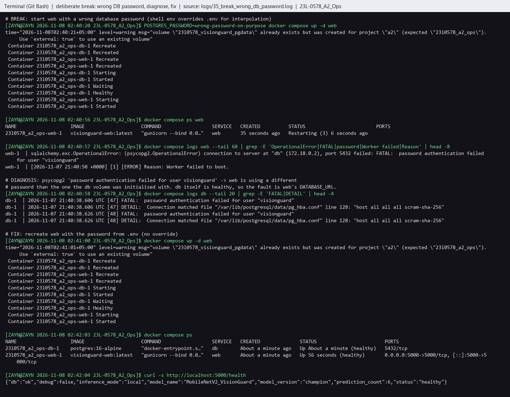

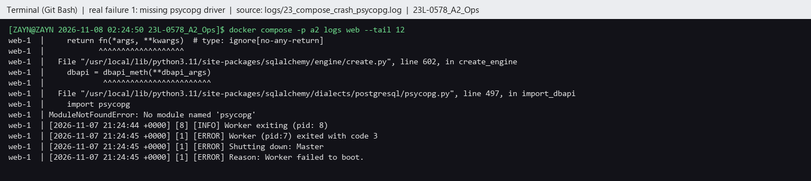

---

## 6.6 — CI with GitHub Actions

### Apply part — VisionGuard workflow

`.github/workflows/ci.yml` runs on every push to `main`/`dev` and on pull requests. One job runs these steps in order, and each step only runs if the previous one passed:

1. `actions/checkout`, then `actions/setup-python` (3.11, pip cache keyed on `requirements.txt`).
2. `pip install -r requirements.txt` — the same pinned versions as local development.
3. `flake8 app/ scripts/ tests/` — configuration in `.flake8` (line length 100, a few justified ignores).
4. `pytest tests/ -v` — 11 tests: preprocessing shape/range, threshold logic, missing file part, the three validation failures, `/health`, the upload page, a full upload that writes a row and shows it on `/history`, and the Postgres-driver regression test. A stub model stands in when `models/champion.keras` is absent.
5. Create a tiny stand-in `champion.keras` (same input/output shape), then `docker build`. The real model is a 19 MB git-ignored binary versioned in the MLflow registry, so CI only checks that the Dockerfile builds.

**What went wrong:** the first runs on GitHub were red. Run `0722d3f` failed, and run `17365d0` failed at the flake8 step because three new helper scripts had lines over 100 characters; locally I had linted before adding them. After wrapping those lines, flake8 reports 0 locally (`logs/37_flake8.log`) and the next push was re-run. The badge at the top of `README.md` points at this workflow and shows its latest status.

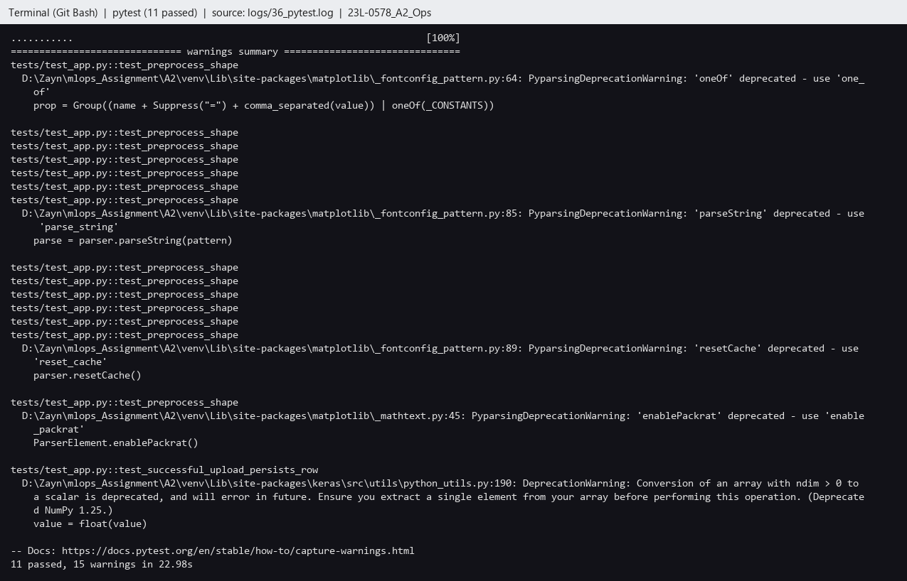

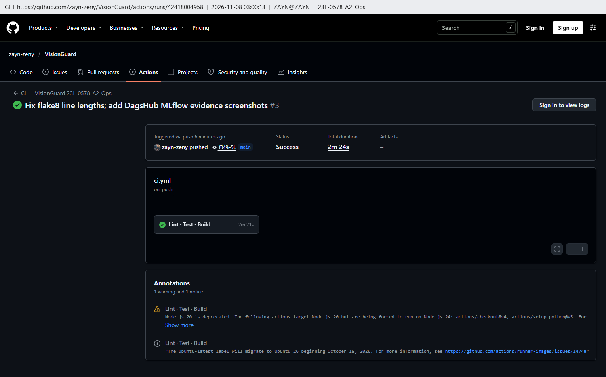

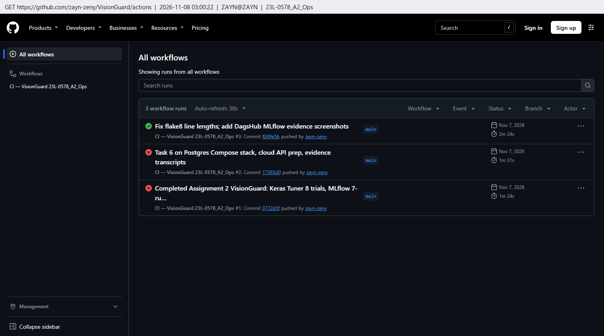

**Where workflow secrets live and why not in the file:** in the repository under *Settings → Secrets and variables → Actions*, referenced in YAML as `${{ secrets.NAME }}`. The values are encrypted at rest, injected only into the runner's environment, and masked as `***` in logs. A literal in `ci.yml` would be in Git history forever, visible to anyone who can read or fork the repository, and copied into every clone. Rotating a leaked key would not remove it from old commits. This workflow currently needs no secrets, because tests use SQLite and a stub model.

### Toy part — red then green

`labs/06_ci_toy/` contains a throwaway project: `test_toy.py` (two tiny tests) and `.github/workflows/ci.yml`, which runs on every push with a **matrix of Python 3.10 and 3.11**. It is pushed to its own throwaway repository. Breaking `add()` (`return a - b`) gives a red run in both matrix legs, and restoring it gives a green run.

{{CI_TOY_SCREENSHOTS}}

---

# Chapter 7 — API Deployment (15 marks)

**Pathway: the model API on Vercel, with Flask and the database on localhost.** This is the split Task 7 asks for: "put model on a cloud/vercel and make api calls from flask. Flask (itself) code will be running on localhost."

**API URL: `https://23l-0578-a2-ops.vercel.app/predict`** (health check: `https://23l-0578-a2-ops.vercel.app/health`)

## 7.1 — Choosing the platform (what I researched first)

| Option | What I found | Outcome |
|--------|--------------|---------|
| Hugging Face Spaces (Docker) | My first plan. After creating the account I found Docker Spaces now need a paid plan; free accounts only get Gradio Spaces on ZeroGPU. | Dropped: no credits on a free account. |
| Azure for Students | Free with no card, but needs an eligible student account. | Dropped: my account was not eligible. |
| AWS EC2 / Google Cloud Run / Oracle VM | Run full TensorFlow comfortably, but all need a credit card at sign-up. | Not available to me. |
| Render / Koyeb free | 512 MB RAM; TensorFlow + MobileNetV2 needs about 700–900 MB. | Would only work with a smaller runtime. |
| **Vercel (Hobby)** | Free, GitHub sign-up, no card. Python serverless functions. **~250 MB function size limit, ~4.5 MB request body limit, no persistent disk.** | **Chosen**, after shrinking the model runtime (below). |

**The size problem and how I solved it.** Full TensorFlow is about 1.4 GB installed, which can never fit a 250 MB function. The model itself does not need TensorFlow to *run*, though. `scripts/export_tflite.py` converts the champion Keras model to a **float32 TFLite** flatbuffer, and the API runs it with **LiteRT** (`ai-edge-litert`, the stand-alone TFLite interpreter, a few MB). I did not quantise, so the arithmetic stays the same, and I measured that rather than assuming it:

```
keras  : 19.3 MB
tflite : 8.9 MB
test images compared : 146
max |p_keras - p_tflite| : 2.77e-06
mean |p_keras - p_tflite|: 4.26e-07
label flips at threshold 0.4: 0
```

Over the entire test split the largest probability difference is 0.0000028, and **not a single label changes** (`logs/40_export_tflite.log`). The deployed bundle is the 8.9 MB model plus NumPy, Pillow, FastAPI and LiteRT.

**The request-size problem.** Vercel rejects bodies above about 4.5 MB before the function even runs, but users may upload up to 10 MB. The model only ever sees a 224×224 RGB image, so in remote mode Flask performs the *same* RGB + bilinear squash-resize and sends the result as a **lossless PNG** (about 100 KB). The API's own resize is then a no-op (same size in, same size out), so the model input is bit-identical to the local path. The unit test `test_remote_payload_preserves_model_input` asserts exactly that. Without this step, the 10.2 MB test upload is refused by Vercel's edge with `413 FUNCTION_PAYLOAD_TOO_LARGE` (SS_45).

**Mapping my Compose stack to Vercel:** the `web` image's inference code becomes one Python function, `vercel_api/api/index.py`. The model is bundled into the function (`includeFiles: model/**`), never fetched from DagsHub at request time. `.env` secrets become **encrypted Vercel environment variables** (`REMOTE_API_KEY`, `THRESHOLD`). The health check becomes `GET /health`. HTTPS and the public hostname come from Vercel. The database stays with Flask on localhost (Chapters 5 and 8). Vercel has no persistent disk, which is one more reason the database could not live there.

## 7.2 — What is deployed

`vercel_api/` contains:

- `api/index.py` — FastAPI app. The interpreter is created **once per warm instance** at import time, never per request.
  - `POST /predict` checks the `X-API-Key` header (**401**), the size (**413**), the content type (**415**) and that the bytes decode as an image (**422**). It then runs the training preprocessing (RGB → 224×224 bilinear → `x/127.5 − 1`, which is what `mobilenet_v2.preprocess_input` computes) and returns `{label, confidence, threshold, model, sha256}`.
  - `GET /health` reports that the model is loaded and which runtime is in use.
- `model/champion.tflite` — the exported champion (registry version 2).
- `requirements.txt` — `ai-edge-litert`, `numpy==1.26.4`, `Pillow==10.4.0`, `fastapi`, `python-multipart`.
- `vercel.json` — routes every path to the function, bundles the model and allows 30 s per request.
- `VisionGuard.postman_collection.json` — the Postman tests (7.4).

## 7.3 — Step-by-step deployment

1. **Account.** Signed up at vercel.com with *Continue with GitHub* (Hobby plan, no card).
2. **Token.** Created a personal access token at *Account Settings → Tokens* and saved it in the git-ignored `.env` as `VERCEL_TOKEN`. It is never typed on the command line in clear text, and the transcripts show it as `***`.
3. **Install the CLI on demand.** `npx vercel@65.2.0` (pinned). My first attempt with v39 was refused by Vercel's API: *"This endpoint requires version 47.2.2 or later"*, so I moved to a current release.
4. **Create and link the project** from inside `vercel_api/`:
   ```
   vercel project add 23l-0578-a2-ops
   vercel link --yes --project 23l-0578-a2-ops
   ```
   `link` writes `.vercel/project.json` (project and team IDs) and git-ignores it.
5. **Secrets.** The API key is piped in from `.env`, so it never appears on screen or in a log:
   ```
   printf <value from .env> | vercel env add REMOTE_API_KEY production --sensitive
   printf 0.4 | vercel env add THRESHOLD production
   vercel env ls        ->  REMOTE_API_KEY  Encrypted  Production
                             THRESHOLD       Encrypted  Production
   ```

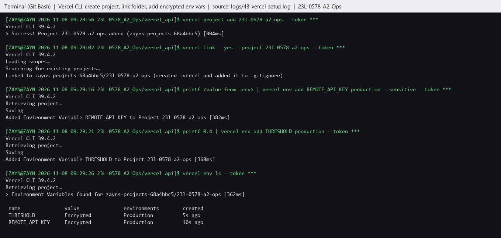

6. **Deploy to production:** `vercel deploy --prod --yes`. Vercel uploaded the 8.5 MB bundle, installed the requirements on its own build machine (2 cores / 8 GB), and aliased the deployment to the production domain:
   ```
   Production  https://23l-0578-a2-qhyuyckgz-zayns-projects-68a4bbc5.vercel.app
   Aliased     https://23l-0578-a2-ops.vercel.app
   readyState  READY   target production
   ```

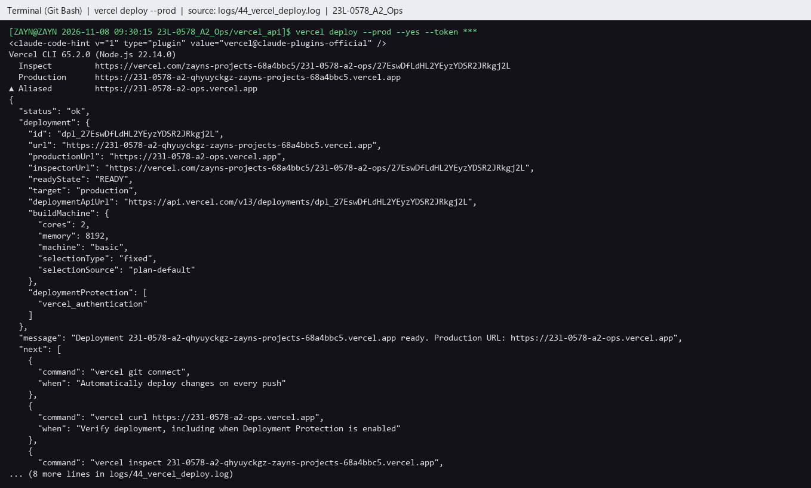

7. **Smoke test** in a browser: `/health` → `{"status":"healthy","model_loaded":true,"runtime":"LiteRT (TFLite)","threshold":0.4}`. *Deployment Protection* (Vercel Authentication) applies to the per-deployment preview URLs only. The production alias is public, which is what an API needs; the API key protects it instead.

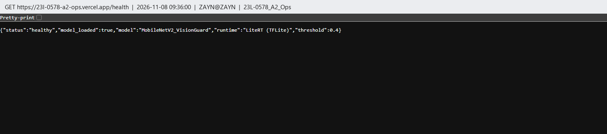

{{DEPLOY_SCREENSHOTS}}

## 7.4 — Testing the live API

**Scripted test** (`scripts/test_remote_api.py`, transcript `logs/45_live_api_test.log`), run from my machine against the production URL:

```
target: https://23l-0578-a2-ops.vercel.app/predict
GET /health -> 200 {"status":"healthy","model_loaded":true,"runtime":"LiteRT (TFLite)","threshold":0.4}
[AI  ] bDSF6saJUuPLsEu9i3ud--1--gvs7i.jpg            -> 200  1015 ms  AI-generated  0.5523
[AI  ] 6324662e5ee3110438933c1b_COBE-Pink-Elephant-M -> 200  1372 ms  AI-generated  0.7257
[AI  ] landscape-art-ai-generated-photo2.jpg         -> 200  2211 ms  AI-generated  0.8603
[Real] 360_F_380747975_sS1hCVB0qPqFCWBMZ3qJ5xTqH6rta -> 200   756 ms  Real          0.1519
[Real] 33100scr.jpg                                  -> 200  1682 ms  Real          0.0205
[Real] the-essay_58_resurgence-of-the-people_2019-ar -> 200  1670 ms  Real          0.0145
correct: 6/6
[error] missing API key  -> 401  {'detail': 'Invalid or missing API key.'}
[error] wrong file type  -> 415  {'detail': 'Unsupported content type: text/plain'}
[error] corrupt image    -> 422  {'detail': 'Cannot decode image: cannot identify image file ...'}
[error] oversized file   -> 413  Request Entity Too Large  FUNCTION_PAYLOAD_TOO_LARGE  (bom1::...)
```

All six probabilities equal the in-container Keras values in Chapter 5 to four decimals. The oversized request never reached my code: Vercel's edge in `bom1` (Mumbai, the nearest region) rejected it, which confirms the platform limit I designed around. Round trips take 0.75–2.2 s, compared with 30–100 ms for the same API locally. The difference is network latency to Mumbai plus serverless cold starts, and it is noted as a limitation.

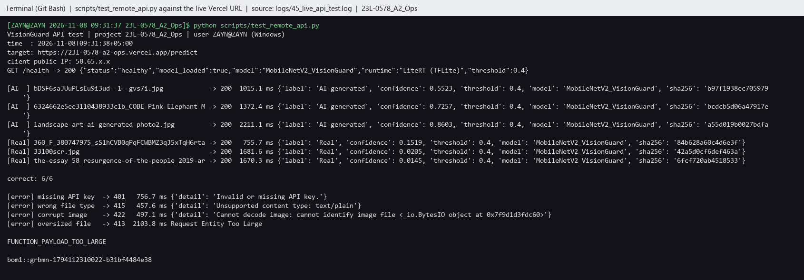

**Postman.** `vercel_api/VisionGuard.postman_collection.json` has five requests with assertions: health; AI image; real image; missing key (expects 401); wrong file type (expects 415). `base_url` and `api_key` are collection variables, so the key is not stored in the exported file.

{{POSTMAN_SCREENSHOTS}}

**Tested from another network.** {{OTHER_NETWORK}}

**Security.** The API requires a shared secret in `X-API-Key`. The key exists only in `.env` locally and as an encrypted Vercel variable, and it travels only over HTTPS. Without it, anyone could use up the free-plan execution quota. No upload is ever written to disk, on either side.

**Limitations.** Cold starts after idle periods, 0.1–2 s of network latency per call, the 4.5 MB body limit (handled by client-side resizing), and the Hobby plan being meant for non-commercial use. A production system would use a container platform close to its users, with a dedicated model server.

---

# Chapter 8 — Integrating Flask with the Cloud API (15 marks)

**How the integration works.** `app/inference.py` has one entry point, `classify(image_bytes, mode, ...)`. With `INFERENCE_MODE=local` it runs the in-process Keras model. With `INFERENCE_MODE=remote` it POSTs the already-validated bytes to `REMOTE_API_URL` as multipart field `image` with header `X-API-Key: $REMOTE_API_KEY`, with a 30 s timeout. It takes `confidence` from the JSON and **applies the threshold locally**, so the Flask app stays the single place where the business decision is made. The view code is identical in both modes, and the database row records `inference_mode`, so the History page shows which path produced each verdict.

Failures are never logged as predictions. A timeout, a connection error, an API 401 (wrong key) or an API 5xx each comes back from `classify()` as an error string, and the view renders a friendly **502** page that names the cause (for example `Inference error: timeout`). Size, type and decodability are validated in Flask *before* the call, so the API's own 413/415/422 checks are a second line of defence for direct callers such as Postman.

**Switching to the cloud API** needs only configuration, no code change:

```
INFERENCE_MODE=remote
REMOTE_API_URL=https://23l-0578-a2-ops.vercel.app/predict
REMOTE_API_KEY=<same secret as the Space>
```

then `docker compose up -d web` (or `python -m flask run` locally).

## 8.1 — Local rehearsal

**Earlier rehearsal of the same integration, with the API on localhost:8000:** three uploads in remote mode were logged with `inference_mode = remote`. Stopping the API mid-session made the next upload fail cleanly with the 502 page (`logs/18_flask_remote.log`).

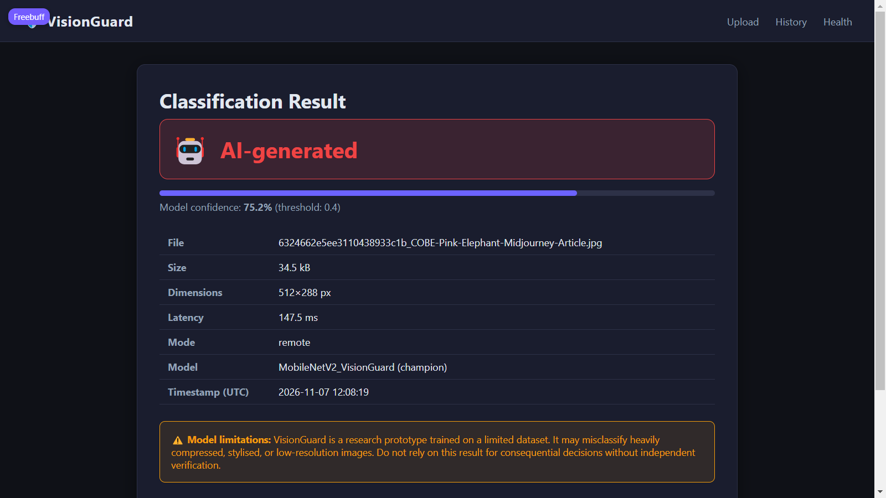

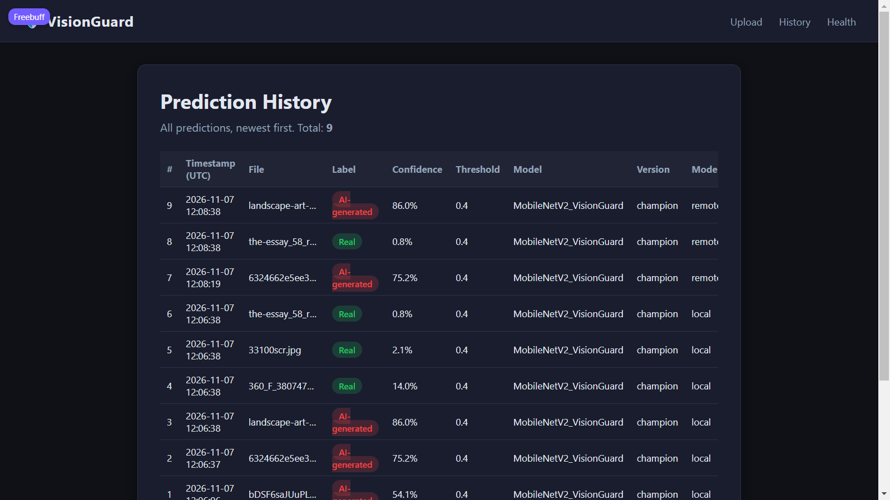

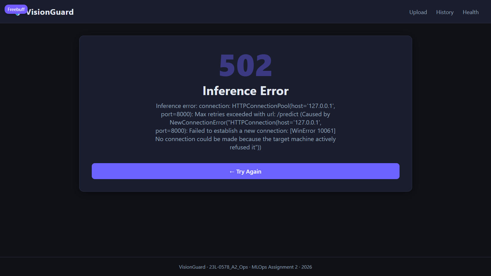

## 8.2 — Live integration: Flask on localhost → Vercel API

**Setup.** The Compose stack from Chapter 6 (Flask + PostgreSQL on my machine) was recreated in remote mode. The URL and key come from `.env`; nothing in the code changed:

```
INFERENCE_MODE=remote docker compose up -d web
curl -s http://localhost:5000/health
{"db":"ok","debug":false,"inference_mode":"remote", ... ,"status":"healthy"}
```

**Multiple inputs.** I uploaded ten images through the web form: eight from the sealed test split, plus two deliberately large files (a 10.2 MB, 3870×5082 px painting and a 5.6 MB AI image). Both large files are over Vercel's 4.5 MB body limit, so they only worked because Flask sends the 224×224 PNG.

| Row | File | Size | True | Verdict (p(AI)) | Correct? |
|-----|------|------|------|-----------------|----------|
| 9 | cafe-terrace-on-the-place-du-f.jpg | 10.2 MB | Real (painting) | AI-generated (0.6088) | ✗ |
| 10 | Earth-Species-project-generative-ai… | 5.6 MB | AI | Real (0.2225) | ✗ |
| 11 | midjourney-v5-drafts-Artboard-4… | 39 KB | AI | Real (0.3671) | ✗ |
| 12 | 1000_F_563719058… | 320 KB | AI | AI-generated (0.9958) | ✓ |
| 13 | cafe-11-header.jpg | 127 KB | AI | AI-generated (0.9885) | ✓ |
| 14 | Deepfake-AI-generated-2023.jpg | 163 KB | AI | AI-generated (0.8404) | ✓ |
| 15 | 1032249.jpg | 646 KB | Real | Real (0.0022) | ✓ |
| 16 | 85220_africa-21787… | 102 KB | Real | Real (0.1314) | ✓ |
| 17 | 5c09c4dc82dc… | 102 KB | Real | Real (0.0025) | ✓ |
| 18 | 360_F_606797008… | 74 KB | Real | AI-generated (0.7759) | ✗ |

Six of ten are correct, and each mistake fits the error analysis in §2.6. Van Gogh's *Café Terrace* is a **real painting** whose smooth, stylised texture the model reads as synthetic. The Midjourney draft board and the Earth-Species scene are AI images in an illustrative style rather than a photoreal one. Every verdict, including the wrong ones, is shown with its confidence and the limitations notice. That is the honest caveat the brief asks the UI to carry.

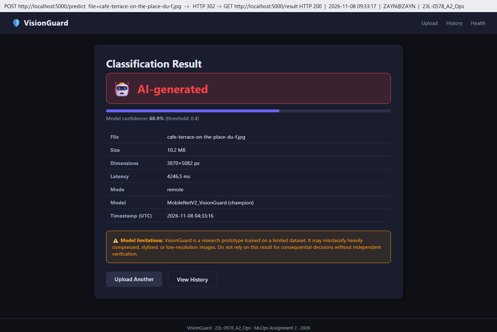

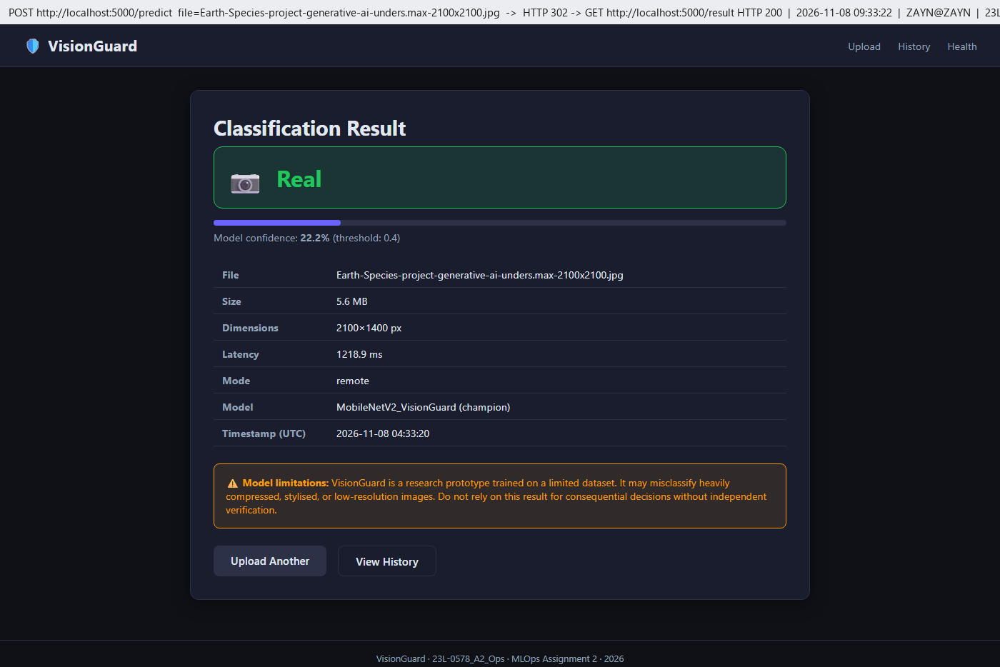

**Same image, local vs cloud.** Three images that had already been classified locally were sent again through the live API. The database matches them by SHA-256:

```
 local_id | remote_id | file                               | local_conf | remote_conf | same_label
        5 |        20 | 33100scr.jpg                       |     0.0205 |      0.0205 | t
        3 |        19 | landscape-art-ai-generated-photo2. |     0.8603 |      0.8603 | t
        1 |        21 | bDSF6saJUuPLsEu9i3ud--1--gvs7i.jpg |     0.5523 |      0.5523 | t
```

The Keras model in the local container and the TFLite model on Vercel agree exactly. The preprocessing contract (training ↔ Flask ↔ cloud) holds end to end.

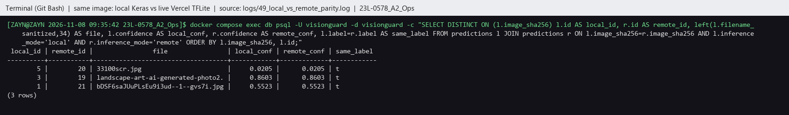

**History menu / database log.** The History page shows every request, local and remote, newest first, with timestamp, label, confidence, threshold, model, version and mode. The same rows are in PostgreSQL (`logs/48_postgres_trail_remote.log`): 8 local and 13 remote predictions.


**Failure handling against the live API.** I recreated `web` with a wrong key (`REMOTE_API_KEY=wrong-key-on-purpose`). Vercel answered 401, and Flask showed the friendly **502** page naming the cause (`Inference error: unauthorized (401)`) instead of a stack trace. **No row was written**, because failed predictions must not appear in the audit trail as if they were verdicts. Recreating `web` with the key from `.env` restored service (`logs/47_remote_wrong_key.log`).


---

# Bonus — Grad-CAM

`scripts/gradcam.py` computes Grad-CAM on MobileNetV2's last convolutional layer (`Conv_1`, 7×7×1280) for the champion model. With Keras 3 the functional sub-model of a nested `Sequential` cannot be sliced directly, so the gradient model is rebuilt explicitly: input → MobileNetV2 base (exposing `Conv_1`) → the trained head layers. At the script's fixed 0.5 cut-off the champion had 58 correct AI, 52 correct real and 36 wrong predictions on the 146 test images (one more error than at the deployed 0.40 threshold in §2.6). The grid shows four correct and four wrong cases.


**What the model looks at.** In the correct AI cases the heat sits on the *subject's rendered texture*: the over-detailed fur of the creature, and the ornate, flower-covered elephant. These are the hyper-detailed, slightly plastic surfaces typical of diffusion models. In the correct real cases the activation is weak and diffuse (the crowd photo has almost no hot region at p = 0.02), which suggests "real" is the default when no synthetic texture cue fires. The wrong cases show the same mechanism failing. The AI portrait pair gets attention on skin between the faces but scores only 0.37, because photoreal skin carries no obvious artefact. The pastel garden and the rooster get attention on *background* flowers rather than the subject. The real fantasy painting (p = 0.78) lights up its saturated, glowing sky — painted smoothness that the model confuses with generation. Grad-CAM agrees with the error analysis in §2.6: the model learned local texture statistics, not semantic cues such as impossible anatomy or inconsistent lighting.

---

# Submission Checklist

| Item | Status |
|------|--------|
| PDF report `23L-0578_VisionGuard.pdf` | ✅ generated from `report/report.md` by `scripts/build_report.py` |
| GitHub repository | ✅ https://github.com/zayn-zeny/VisionGuard (code, split lists, DVC pointer, figures, screenshots, transcripts) |
| DagsHub project | ✅ https://dagshub.com/zayn-zeny/VisionGuard — DVC data, 7+1 MLflow runs, registry with `champion` alias |
| CI badge in README | ✅ |
| `.env.example` in repo, `.env` git-ignored | ✅ |
| Dockerfile, `.dockerignore`, `docker-compose.yml` | ✅ stack verified healthy on Postgres |
| Live API URL | ✅ https://23l-0578-a2-ops.vercel.app/predict |
| Postman test evidence | {{CHECK_POSTMAN}} |
| API tested from a different network | {{CHECK_NETWORK}} |
| Graded commit hash in front matter | filled in at submission |
